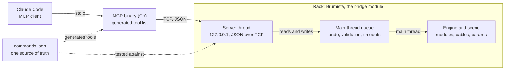

# W72 — Technical Foundations

2026-11-01

## At a glance

W72's first deliverable is a Rack module and a small MCP binary, built from one repo and one command list. The plugin has since grown modules that run inside Rack on their own (Ghisa, Moleta and its expander Moleta +, Gibigiana and its lane expander Gibigiana +, Barbapedana); the diagram is the bridge only.



Every command that touches the engine or the scene, read or write, is queued and run on Rack's main thread, where undo and validation happen. Only commands that read plugin data, which doesn't change while Rack runs, answer straight from the server thread.

## Repository and sync

One GitHub repository, `w72-rack-plugin`, holds the plugin, the MCP binary and the protocol definition, released together under one version number. The plugin sits at the repo root, because the VCV Library builds a plugin from its repository at a given commit and has no setting for a subfolder.

```
w72-rack-plugin/
  plugin.json             the Rack plugin, slug W72
  Makefile
  src/                    C++: Brumista, Ghisa, Moleta, Moleta +, Gibigiana, Gibigiana +, Barbapedana, and W72's own parts
                          (widgets.hpp; MoletaEngine.hpp, GibigianaEngine.hpp and BarbapedanaEngine.hpp, DSP with no Rack includes)
  res/                    panels (SVG), generated; fonts/ holds the readout's Inter Tight weight
  panels/                 one description per panel
  tests/                  host tests of Moleta's, Gibigiana's and Barbapedana's engines and Brumista's engine watch (not in the plugin package)
  tools/panelgen/         the panel generator, Go (not in the plugin package)
  mcp/                    the MCP server, Go (not in the plugin package)
  protocol/
    commands.json         every command: name, parameters, description
    protocol.go           embeds commands.json for the Go code
    limen/commands.json   limen's commands, the parity oracle
  docs/
    concept.md
    architecture.md       this document
    design-system.md      the panel style
    modules/              one page per module; each module's manualUrl
  CLAUDE.md               what every Claude Code thread reads first
```

The sync procedure keeps the two artifacts from drifting:

1. **One source of truth.** `protocol/commands.json` lists every command. The Go server generates its MCP tool list from it. The C++ dispatch table is handwritten and checked against it by `tools/check-commands.sh` in CI: the same commands, in the same order, on the same thread, and marked as reads or patch edits alike (the edit mark drives Brumista's CMD light). `hello` builds its command list from that table, so a live `hello` agrees with the file too. Generating the C++ is a fallback if drift becomes a problem. Adding a command is one edit, and a mismatch fails the test.
2. **One version, semver.** `plugin.json`'s version, the binary's version and the protocol version move together under Semantic Versioning. Rack pins the major version to its own (2.x for Rack 2), so new commands or modules are minor bumps and fixes are patches. A release tags all three.
3. **A version handshake.** The module's `hello` reports its protocol version. The binary refuses a version it doesn't know, or warns, so an old pair says so instead of half working.
4. **Separate distribution.** The plugin goes through the VCV Library (accepted 2026-11-05, listed as "W72 by WinterOf72"); the binary ships as prebuilt files on GitHub Releases, built by GitHub Actions. This is how forsitan modulare does it ([limen-tools](https://github.com/gosub/limen-tools/releases)). The Library has no written rule on executables inside a plugin, but it builds plugins from source with a C++ toolchain, and macOS would likely block an unsigned executable.

## The bridge module

Brumista is a TCP server inside Rack. Commands that touch the patch run on Rack's main thread; only plugin and model lists answer from the server thread. limen has the same shape: one file of about 1,165 lines (`src/limen.cpp` in forsitan modulare `master-v2`), with no DSP.

- **Server thread.** Listens on `127.0.0.1` only, one client at a time, with one JSON object per line. It polls its sockets every 100 ms so it can stop cleanly; on Linux, closing a socket from another thread doesn't reliably wake it. Sends never raise `SIGPIPE`, so a client that hangs up can't take Rack down. If the port is taken (a second Brumista), it retries every second.
- **Main-thread queue.** Anything that touches the engine or the scene, reads included, is queued as a function and run in the module widget's `step()`. Reading from the server thread races with the main thread removing a module. The server thread waits 2 s for the result.
- **Timeouts cancel.** A command still queued when the wait ends is cancelled and never runs, so a client told "timeout" can trust nothing happened. One the main thread has already started is waited for until it finishes. limen leaves timed-out work in the queue to run later.
- **Port.** 7200 by default, not limen's 7000, so both modules can sit in one patch while W72 is being built. A field in the right-click menu sets another (1024 to 65535), saved in the module's `data` as `port`. The port is an atomic the server thread watches: on a change it closes its listener and any client within one 100 ms poll and binds the new port, so the menu and `dataFromJson` never wait on a thread join. A taken port retries every second, as at start.
- **Cables as Rack makes them.** Every new `CableWidget` gets a colour: the requested one, or `RackWidget::getNextCableColor()`. limen does the same since forsitan 2.17.1; before that it set none, which left Rack's default of transparent black ([forsitan-modulare#24](https://github.com/gosub/forsitan-modulare/issues/24)).
- **Undo.** Each write records one Rack history step (cable add or remove, module add, move or remove, parameter change), so Ctrl+Z works on an agent's edits. Writes record through one function, which a batch points at a `ComplexAction` so the whole batch is one step. `remove_module` calls Rack's own Delete, which pushes its step itself; inside a batch it is taken back off the history into the group.
- **A batch is one main-thread task.** `batch` runs all its commands in a single queued function, so no frame falls between them and a client sees the patch only before or after. The 2 s wait covers the batch's start; the MCP binary allows 30 s for its reply. limen runs a batch on the server thread and sends each write to the main thread on its own.
- **Saving as Rack's menu saves.** `save_patch` without a path is Rack's Save; `save_patch_as` is Save as, which makes the file the patch's own and adds it to the recent patches. Both mark the patch saved before writing, as Rack does, so the file doesn't carry Rack's unsaved mark. `save_patch` with a path writes a copy and leaves the patch's file and unsaved state alone. Any explicit path must be absolute, in a folder that exists, and gets `.vcv` when it lacks it; an existing file is replaced only when the call sets `overwrite`. limen overwrites silently and leaves the patch marked unsaved. Saves get the MCP binary's 30 s reply window, as a batch does.
- **The view isn't the patch.** `set_fullscreen` and `zoom_to_modules` change the window and the view, not the patch, so they record no undo step. Both run on the main thread, which owns the window and the widgets: `zoom_to_modules` calls Rack's own F4 before replying and again in the next two frames, from Brumista's widget `step()`. A single call sets the zoom but leaves the offset clamped against the old view, so the modules land off screen; limen repeats it over three frames for the same reason.
- **Reading state on the main thread.** `list_params`, `list_ports` and `get_module_data` read per module, in the main-thread task, as Rack's tooltips do: a read takes no engine lock, so the audio thread never waits on it. A param's `display` is the module's own `getDisplayValueString()` plus its unit, from the `ParamQuantity`, so it shows a smoothed knob's target, as the tooltip does; `value` stays the engine's raw value. A port's channel count is read once and capped at 16 before its voltages, since the engine writes the two apart. Voltages are instant samples; anything faster waits for windowed statistics in Measuring. `get_module_data` returns the module's `dataToJson()`, the `data` a patch file holds for it.
- **Parameters as a knob sets them.** `set_param` goes through the `ParamQuantity`, which clamps to the range and rounds stepped parameters, and replies with the value that resulted.
- **Screenshots drawn offscreen.** `screenshot_module` and `screenshot_rack` draw on the main thread, between frames, into a `FramebufferWidget` sized for the image, and read it back with `glReadPixels`, as Rack's `-t` does for its module images. A module is drawn alone (panel, then the light layer), with its live state; the rack is drawn by `RackWidget::draw` clipped to the box around the modules, so plugs, cables and room brightness come out as in the window, wherever the view is. The PNG is encoded by a static copy of `stb_image_write` (Rack's copy offers plugins only file output), sent as base64 in the reply, and turned into an MCP image by the binary, which marks such commands with `image` in `commands.json`. Images are capped at 4096 px a side; a batch refuses screenshots, since an image in its results would reach the client as text.
- **Watching the engine.** Rack's engine stops when the primary audio module has no device to drive it, and every command still answers then, so a stopped engine is easy to misread as a module's bug. Brumista's widget `step()` samples the engine's frame counter every frame; once it has stood still for half a second, `hello` reports `engine.running: false` and a `warning` naming the primary module. The watch reads the engine, not Brumista's own `process()`, which a bypassed Brumista skips, and rests only on what it has seen, so a window held up by a file dialog doesn't make a running engine look stopped (`src/BrumistaEngineWatch.hpp`, host-tested). The MCP binary's server instructions tell agents to call `hello` first.
- **Validate before acting.** Port indices are checked against what the panel actually exposes, and every command is wrapped so an exception becomes an error reply instead of a Rack crash. Through limen, a cable to a port with no panel jack (on NYSTHI Programmer) took Rack down: Rack's `CableWidget::setCable` throws once the engine already holds the cable. Arguments, placement mode included, are checked before anything changes. Brumista refuses to remove a Brumista module, since its commands run inside that widget's `step()`.

## Features and milestones

The first milestone matches what limen does today, without its problems. Each later one adds a capability limen doesn't have. limen's surface (forsitan 2.17.2, protocol 2) is captured in `protocol/limen/commands.json`: each command's params, result shape and error strings, plus the problems Brumista must not repeat.

1. **Parity, done properly.** `hello`, list modules, params, ports and cables, add, move and remove modules, set params, add and remove cables, batch, save as. Plus cable colours, undo history and validation from the start.
    - Done when: a full patch section can be built end to end, with cables in the requested colours.
    - The commands still missing after the read-only ones ship in four groups, in order:
        1. Patch edits: `set_param`, `add_module`, `remove_module`, `move_module`, `add_cable`, `remove_cable`, each with its undo step.
        2. `batch`, built on group 1. A whole batch undoes as one step.
        3. Saving: `save_patch` and `save_patch_as`. Neither replaces an existing file unless the call asks for it.
        4. View: `set_fullscreen` and `zoom_to_modules`, last or alongside saving.
    - `quit` stays out: it closes Rack with no save prompt.
2. **Seeing state.** Read what a module shows: parameter values with labels, units and display strings, and instant port voltages with channel counts. Then a module's JSON state read live (`dataToJson`), for what the panel doesn't show. Reads stay per module, so a reply stays small.
    - Done when: a quantizer's output voltage and a mixer's gain trims, as the panel displays them, can be read from a running patch, and so can a quantizer's scale mask.
3. **Seeing the rack.** Take a screenshot of a module or the whole rack, rendered in process. It comes right after the state reads because it fills the gaps they leave: moving signals, displays drawn by the widget, lights, layout.
    - Done when: Claude can look at a panel without you taking a screenshot.
4. **Building blocks.** Load a `.vcvm` preset into a module and add a `.vcvs` selection at a position. Stoermelder PackOne (8FACE, STRIP) is the prior art. Also set a cable's colour after the fact, with its undo step.
    - Done when: a saved selection can be dropped into a patch by name.
5. **Measuring.** Keep windowed voltage statistics (min, max, mean) taken in `process()`, so nothing between two reads is missed.
    - Done when: Claude can check that a quantizer output moves, or that a poly cable carries four channels, without asking you to listen.
6. **Opening patches.** Open a patch. It replaces the whole scene, so it refuses to run over an unsaved patch unless the call says so.
    - Done when: Claude can switch to a saved patch without losing unsaved work by accident.

Milestones 1 to 3 are done, the last of them (screenshots) in 2.5.0; 4 to 6 are open.

Further modules come in parallel with these: Ghisa (2.3.0) and Moleta with its expander (2.8.0) have shipped, Gibigiana is built for 2.9.0, and Scighera is next. Their specs come from technique cards.

## The MCP binary

The MCP server is a small Go program that speaks MCP over stdio to the client and the module's protocol over TCP to Rack. Users download one executable; nothing else to install.

- **Why Go.** One static executable, no runtime. It cross-compiles to Windows, Linux and macOS by setting `GOOS` and `GOARCH`. There's an official MCP SDK (`modelcontextprotocol/go-sdk`). Python was ruled out because users would have to install it.
- **Its job is thin.** Generate the tool list from `protocol/commands.json`, forward each call to the module, return the reply. No patch logic lives in the binary.
- **Its name.** The MCP server takes the bridge module's name, Brumista, which becomes the tools' prefix (`mcp__brumista__add_cable`).
- **Its tools.** One tool per command in `protocol/commands.json`, with the same name, description and parameters. `protocol/` is a small Go module that embeds the file, so the binary reads the one source of truth rather than a copy. A tool call returns the command's `result` as JSON text; an error reply or a failed connection comes back as a tool error the model can read.
- **One connection per call.** Each call connects, sends `hello`, sends the command and closes. Brumista serves one client at a time, so a held connection would lock out every other client. Calls from one binary run one at a time, since Brumista's listen backlog is 1 and a burst of parallel connections is refused.
- **The handshake.** The binary refuses a server whose `hello` doesn't name Brumista (limen answers `hello` too) and a module on another major version. Any other version mismatch works, with a warning on stderr.
- **Configuration.** `-host` and `-port`, defaulting to `127.0.0.1` and `7200`. Registered in Claude Code with `claude mcp add brumista -- <path>/brumista-mcp`.
- **Releases.** Pushing a tag `vX.Y.Z` that matches `plugin.json` runs `.github/workflows/release.yml`, which builds `brumista-mcp-X.Y.Z-<os>-<arch>` for Windows, Linux and macOS and publishes them, with `SHA256SUMS`, as a GitHub Release. `mcp/version.go` holds the version; a test checks it against `plugin.json`.
- **The one-artifact alternative.** The module could serve MCP over HTTP itself (localhost only, an `Origin` check and a token). That's kept in reserve, since two artifacts with a sync procedure are acceptable.

## Toolchain and build

The plugin builds natively on Windows with MSYS2 (MinGW64) and the Rack SDK, VCV's documented setup.

| Piece | What it is |
| --- | --- |
| MSYS2 (MinGW64) | Compiler, `make` and shell, installed with one `pacman` line |
| Rack SDK | Zip of headers and build files matching the Rack version (`Rack-SDK-2.x-win-x64`); `RACK_DIR` points at it |
| Go | Builds the MCP binary for all platforms |

The build loop:

1. Close Rack, since Windows locks a loaded plugin `.dll`.
2. `make install` at the repo root, which builds and copies the plugin into Rack's user `plugins-win-x64/` folder.
3. Start Rack and test.

Cross-compiling from Linux (VCV's `rack-plugin-toolchain`, or mingw-w64 with the `-posix` g++) is the alternative. It's worth it only to check Linux and macOS builds ahead of a Library update, and the Library builds those itself. CI already compiles Linux and macOS.

Changes land through pull requests with Conventional Commits messages. A lightweight GitHub Actions CI builds and tests the Go server, checks `commands.json` against both sides, runs the host tests of Moleta's and Gibigiana's engines and Brumista's engine watch (`make test-engine`, no SDK needed), and compiles the plugin against the Rack SDK on Linux, macOS x64 and macOS arm64. Release builds of the binary come from the same Actions setup.

### Releasing

1. A `chore(release): X.Y.Z` pull request bumps `plugin.json` and `mcp/version.go`; merge it once CI is green. A change that only touches docs skips the workflow, so it has no checks to wait for.
2. Tag `vX.Y.Z` on the merge commit (annotated, message `W72 X.Y.Z`). The release workflow builds `brumista-mcp` for five platforms and publishes it with `SHA256SUMS`.
3. Put a short summary of what is new above the generated release notes.
4. Comment the version and commit on the Library issue (VCVRack/library#1010); the Library rebuilds from that commit and lists the new version some time later.
5. Close the milestone. To use the new build locally, install the plugin and rebuild the MCP binary from the tag.

## Where work runs

Development runs as a Claude Code Project: a coordinator plus threads. Work that needs Rack or the Windows build runs in local threads on the development machine, and everything else can run in the cloud.

| Work | Thread | Why |
| --- | --- | --- |
| Design, specs, docs, reviews | Cloud | Needs only the repo |
| Go MCP binary: code, tests, cross-builds | Cloud | Builds anywhere |
| C++ code that a compile check can verify | Cloud | A Linux compile catches most errors |
| Host tests: Moleta's and Gibigiana's engines, Brumista's engine watch (`make test-engine`) | Cloud | Host compiler only, no Rack SDK |
| Windows build and `make install` | Local (Remote Control) | Needs MSYS2 and the Rack folder |
| Live tests against a running Rack | Local (Remote Control) | Needs Rack, limen and rackmaster |

## How the project uses rackmaster

rackmaster, a Claude Code plugin for VCV Rack, is the project's main source of context: a local index of installed modules with manuals, technique cards and errata. Every thread checks it before writing code that something else may already do.

| Part | Used for |
| --- | --- |
| Module index | Name and slug collisions; gap checks, so sound modules fill gaps instead of adding a twenty-first shimmer |
| Manuals and source | Prior art: Stoermelder PackOne for presets and module state; Plateau for reverb structure; existing shift registers for Ghisa |
| Technique cards | Specs for sound modules; the patches they were found in become test patches |
| Errata and conventions | A checklist of mistakes not to repeat |

Errata that become rules for W72:

- **Refuse cables to hidden ports**, from the NYSTHI Programmer crash.
- **Declare ports in enum order**, from Cella Resonators, whose port ids disagree with its declaration order.
- **Show momentary state**, from Dopamine's Record param, which reads 0 at rest.
- **Expose real state to the patch**, from quantizers whose scale mask is invisible to parameters.

W72 modules also get rackmaster manuals from the start, written next to the code.

## Licence and naming

The plugin and the MCP binary are GPL-3.0-or-later. That allows reusing limen, limen-tools and Stoermelder code, which are all GPL-3, and it's the licence VCV recommends.

- **Slugs:** plugin `W72`. Module slugs in plain ASCII, permanent once a patch uses them.
- **No "VCV"** in any name, slug or binary name.
- **The binary's name** follows the bridge module, for example `brumista-mcp`.
- **Naming grammar and glossary:** in [concept.md](concept.md).

## Decisions

| Decision | Date |
| --- | --- |
| Repo `w72-rack-plugin`; plugin slug and name `W72` | 2026-11-01 |
| Port 7200; the MCP server takes the bridge module's name | 2026-11-01 |
| `commands.json` is a test oracle; generate only if drift becomes a problem | 2026-11-01 |
| No executable in `res/`; the binary ships on GitHub Releases | 2026-11-01 |
| Plugin at the repo root, so the Library can build it | 2026-11-01 |
| Milestones: parity, seeing state, building blocks, measuring, seeing the rack | 2026-11-01 |
| Milestones reordered: parity, seeing state (values, voltages), seeing the rack (screenshots), building blocks, measuring (windowed statistics); `dataToJson` joins seeing state, cable colour edits join building blocks, opening a patch comes last | 2026-11-02 |
| GPL-3.0-or-later for plugin and binary | 2026-11-01 |
| Pull requests for every change; Conventional Commits | 2026-11-01 |
| Semantic Versioning, one version for plugin, binary and protocol (`2.MINOR.PATCH`) | 2026-11-01 |
| Lightweight GitHub Actions CI once there is code | 2026-11-01 |
| The bridge module is Brumista (slug `Brumista`); the MCP server takes the same name | 2026-11-01 |
| Panels are dark only; the W72 mark is the only element taken from the W72 web design system | 2026-11-01 |
| Panel style Metropolitana: a family-coloured band, Inter Tight outlines, a light output plate ([design-system.md](design-system.md)) | 2026-11-01 |
| Panel design is decided on a Claude Design canvas; panel SVGs are built by a generator in the repo | 2026-11-01 |
| The panel generator is written in Go | 2026-11-01 |
| Panel descriptions place controls by row (counted from the bottom) and order, never by coordinate | 2026-11-01 |
| Control positions reach the C++ through a generated `src/<Slug>Panel.hpp`, not a hidden SVG layer | 2026-11-01 |
| Static Inter Tight files (OFL) live in `tools/panelgen/fonts/`, outside the plugin package | 2026-11-01 |
| limen's command surface is captured in `protocol/limen/commands.json` as the parity oracle, apart from W72's own `protocol/commands.json` | 2026-11-01 |
| Every command that touches the engine or the scene runs on the main thread, reads included | 2026-11-01 |
| A command that times out before the main thread starts it is cancelled and never runs | 2026-11-01 |
| `hello` reports `server` and the semver `version`, not an integer protocol number | 2026-11-01 |
| The MCP binary uses the official Go SDK (`modelcontextprotocol/go-sdk`) and embeds `commands.json` through a `protocol` Go module | 2026-11-01 |
| The MCP binary opens one connection per call and runs its calls one at a time | 2026-11-01 |
| Release binaries are plain executables per platform, published by a tag-triggered workflow | 2026-11-01 |
| The first release is v2.1.0, tagged when Brumista reaches parity with limen (milestone 1) | 2026-11-01 |
| The remaining parity commands ship in four groups: patch edits, batch, saving, view; `quit` is left out | 2026-11-01 |
| A whole `batch` undoes as one step; writes record undo through one function a batch can group | 2026-11-01 |
| `save_patch_as` refuses to overwrite an existing file unless the call asks for it | 2026-11-01 |
| A `save_patch` copy follows the same rule: an explicit path never replaces a file unless `overwrite` is true | 2026-11-01 |
| Saves follow Rack's menu: the patch is marked saved, paths must be absolute and get `.vcv` when missing | 2026-11-01 |
| `set_param` clamps and snaps through the `ParamQuantity` and replies with the resulting parameter | 2026-11-01 |
| A cable with no colour takes Rack's next cable colour; choosing colours by signal is the caller's job | 2026-11-01 |
| `remove_module` goes through Rack's Delete, and refuses a Brumista module | 2026-11-01 |
| `batch` runs as one main-thread task and keeps limen's reply shape; commands that ran before a failure stay done and undo together | 2026-11-01 |
| `set_fullscreen` and `zoom_to_modules` run on the main thread and record no undo step; zooming is Rack's F4, repeated over three frames as limen does | 2026-11-01 |
| Each module has a page in `docs/modules/`, and its `manualUrl` in `plugin.json` points to that page on `main` | 2026-11-02 |
| Seeing state extends `list_params` (`default`, `display`, switch `labels`) and `list_ports` (`channels`, instant `voltages`, always an array) with new fields only, and adds `get_module_data` for `dataToJson`; all per module, on the main thread | 2026-11-02 |
| Display readouts are signage text (Inter Tight SemiBold) drawn live with NanoVG on the light layer; that one weight ships in `res/fonts/` | 2026-11-02 |
| Display ink is white; a highlight colour stays open until a module needs one | 2026-11-02 |
| A quantizer's scale shows as a twelve-light keyboard; rows of states use flat bar lights; single states keep stock round lights | 2026-11-02 |
| A readout takes one 48 px grid row | 2026-11-02 |
| Ghisa is a 16-stage shift register with a drawn tap shape (8 buttons) that a DEPTH knob and CV slide through the register; it has no quantizer | 2026-11-02 |
| Ghisa's shape and DEPTH changes take effect on the next clock | 2026-11-02 |
| Ghisa builds in the bass tap (`bss`'s job): a BASS output beside the poly CHORD | 2026-11-02 |
| A module's working modes go in its right-click menu, not on the panel | 2026-11-02 |
| Ghisa's HOLD is a button and a gate input; while either is on, stage 16 feeds stage 1, so the loop is always 16 clocks (until *Hold loop length*, below) | 2026-11-02 |
| Ghisa's default shape is buttons 1, 3 and 6 | 2026-11-02 |
| Ghisa has a poly CHANGE output: per voice, a trigger when that voice's note moved | 2026-11-02 |
| Ghisa's panel: register display under the band, shape buttons as an unnumbered 2 × 4 grid at 2 HP pitch; rows above the inputs may sit off the 48 px grid | 2026-11-02 |
| W72's own parts (flat button, flat bars) live in `src/widgets.hpp`: the off state on the panel layer, the lit state on the light layer | 2026-11-02 |
| Ghisa's menu modes land on the next clock, like the controls; HOLD's light shows the loop, by button or gate | 2026-11-02 |
| Ghisa's CHANGE can be a gate until the next clock (menu), for envelopes that read a gate; a gate already high drops for 1 ms to retrigger | 2026-11-02 |
| Brumista's port is set in its right-click menu (1024 to 65535, default 7200), saved with the patch, and applied at once by rebinding; the MCP binary follows with `-port` | 2026-11-02 |
| A module's manual page shows Rack's own render of its panel (`Rack -t 2`, saved as `docs/modules/<slug-lowercase>.png`), not the panel SVG, which GitHub draws without knobs, jacks or lights; it is regenerated whenever the panel changes | 2026-11-02 |
| Screenshots are drawn offscreen with Rack's own widgets (`FramebufferWidget`, as `-t` does), not read from the window: a module alone at zoom 2, or the rack's box around all or chosen modules, fitted to 1568 px unless a zoom is given; PNG as base64, an MCP image in the binary | 2026-11-03 |
| Brumista's panel shows two round lights. LINK: off when stopped, slow blink while the port is taken, dim when listening, full with a client. CMD: a short flash per command, dim for a read, full for one that changes the patch. Modem lights with nothing behind them (separate RX/TX, OH, AA, HS, speed) and a port readout (too wide for 3 HP; the port stays in the menu) are left out; an error light waits until it's missed | 2026-11-04 |
| Ghisa's BASS CLOCK input (`BASS CLK`, normalled to CLOCK) holds BASS between its own edges, read from the sounding chord. A bass edge on a main clock reads after the shift, and a main clock within 1 ms after a bass edge counts as the same edge (Rack's one-sample cable delay). Panel: DEPTH and HOLD jacks under their controls, IN, CLOCK and BASS CLK above CHORD, CHANGE and BASS | 2026-11-04 |
| Ghisa's *Chord range* (off, or above C2 to C5) and *Chord width* (1 or 2 octaves) fold CHORD by whole octaves; *By pitch* orders after the fold, CHANGE compares the folded voltages, and BASS reads the taps before the fold | 2026-11-04 |
| Moleta is a master clock (BPM, RUN, RESET) that follows a CLOCK input when one is patched (rising edges only; 1, 4 or 24 pulses per beat in the menu, default 1). Besides its outputs it has a coin-free BEAT, a RESET out and a CLICK audio out; no swing, no BPM CV | 2026-11-05 |
| Moleta has four outputs, each with RATIO, CHANCE and LENGTH; an expander (Moleta +, shipped in 2.8.0) adds four more without changing the base, which then delays its outputs one sample to match Rack's expander latency | 2026-11-05 |
| Moleta's RATIO steps through one curated list (/16 to ×16 with 2/3, 3/4, 4/3, 3/2 and odd ratios); the patch saves the ratio, not the step | 2026-11-05 |
| Moleta's LENGTH: fully left is a trigger, then 5% to 95% of the output's own period | 2026-11-05 |
| Moleta's coin: a CHANCE knob per output plus one shared DENSITY CV; a REPEAT knob loops each output's last 16 (or 8) flips, storing the random numbers so CHANCE still acts on a locked loop; *Follow the output above* is a per-output menu option, off by default | 2026-11-05 |
| When Moleta follows a moving clock, multiplied and fractional outputs realign on the edge where their cycle restarts, drop a pulse still pending then, and stop after about two missed periods | 2026-11-05 |
| Moleta's panel: 18 HP, master section left, four strips right with outputs side by side on the plate, a readout row of BPM and the four ratios, seven columns 37 px apart and 24 px in from the edges | 2026-11-05 |
| W72 holds sound modules as well as studio tools, in one plugin; Scighera is the likely module after Moleta | 2026-11-05 |
| W72 accepted into the VCV Library; each release is followed by a comment on the Library issue with the new version and commit | 2026-11-05 |
| Moleta's fresh-module ratios are ×2, /2, /3 and /4 on outputs 1 to 4: a fast output first and slower ones after, with /3 as the one odd ratio. Chosen from the divider settings used across existing patches (×2, /3, /4, ×4, /2, /8 most common); tuned by ear | 2026-11-05 |
| Moleta's ratios are p pulses per q beats. One output engine, shared by Moleta and Moleta+, restarts each output's cycle on the beats whose count since the reset is a multiple of q, with a pulse, and spreads the other pulses at the rate of the measured period T; it waits at the cycle's end when the clock is late | 2026-11-05 |
| Moleta's RUN turned on restarts the cycles and the coin loops like RESET, without firing the RESET output; stopped, every output is silent and the internal clock frozen | 2026-11-05 |
| Moleta's LENGTH has a trigger step at the bottom (1 ms), then a gate of 5% to 95% of T × q / p, taken when the pulse fires; a pulse on a gate still high drops the output for one sample | 2026-11-05 |
| Moleta's REPEAT redraws the coin slot at the pointer with probability 1 − REPEAT; the pointer advances whether or not the pulse passed | 2026-11-05 |
| *Follow the output above* reads the final result of the output above (its coin and its own follow), so chains cascade; outputs are evaluated in index order each sample, and a chain starts as passed after a reset | 2026-11-05 |
| Moleta sends Moleta+ a message each sample (the clock's tick with its beat count, T, REPEAT, DENSITY and the loop length), pushed into the expander's `leftExpander`; while one is attached, all seven base outputs are delayed one sample | 2026-11-05 |
| Moleta's readout keeps the name BPM while it shows the measured tempo of CLOCK: the name is baked into the panel and nothing paints over it | 2026-11-05 |
| Moleta's DSP is a header with no Rack includes (`src/MoletaEngine.hpp`), tested on the host by `make test-engine` and a CI job, with the random source injected | 2026-11-05 |
| Moleta +'s fresh-module ratios are ×4, ×1, /8 and 3/2 on outputs 5 to 8: the other common divider settings beside the base's ×2, /2, /3, /4, plus 3/2 as the odd one. They live as `PLUS_DEFAULT_RATIOS` beside `DEFAULT_RATIOS` in the engine header | 2026-11-05 |
| Moleta + allocates both `leftExpander` buffers and reads the consumer only while the module on its left is a Moleta; otherwise its outputs are 0 V and it clears the consumer, so a Moleta placed back reads as stopped for its first sample instead of replaying a stale tick | 2026-11-05 |
| Moleta + placed back next to a Moleta waits for each output's next cycle restart (its coin loops kept), so it rejoins on Moleta's beats; output 5 never follows Moleta's output 4, and *Follow the output above* covers outputs 6 to 8 | 2026-11-05 |
| Moleta + saves its ratios as p and q, its coin loops and its follow flags like the base; the clock, *Beats per bar* and *Coin loop* stay on Moleta | 2026-11-05 |
| Ghisa's *Hold loop length* (16, 12, 8, 6, 4 or 3 stages, default 16) changes only HOLD's feedback source: stage *N* feeds stage 1 and the stages above *N* keep shifting, so after at most 16 - *N* clocks they hold periodic copies of the loop and every lit button keeps sounding. Nothing is indexed modulo *N*, so releasing HOLD doesn't jump; saved as `holdLength`, the stage count | 2026-11-05 |
| Ghisa's *Duplicate notes* (*Keep*, *Skip*, *Octave up*) runs after the chord fold and before *By pitch*, so notes that only become equal once folded are caught; "equal" is 1 mV, the tolerance CHANGE already used. *Skip* shrinks the channel count; *Octave up* raises each repeat until it is unique (uncapped, may leave the chord range window). BASS keeps reading the raw taps, so it doesn't depend on the choice; CHANGE needs no new logic, and *Skip* with *By pitch* keeps its channel numbering steady. Saved as `duplicates` | 2026-11-05 |
| Ghisa's DRIFT (knob 0 to 100%, CV 10% per volt) acts only while HOLD loops: on each clock, with chance DRIFT, stage 1 samples IN instead of the loop's last stage. 0% is HOLD as before, 100% is HOLD off; in between, a Turing machine whose new values are the melody's own notes, so no quantizer is needed. Several Ghisas on one melody, each with HOLD and DRIFT, rebuild the cascade tested with chained Morpheus lanes. New param and input go last in their enums, so old patches load unchanged at 0% | 2026-11-08 |
| Ghisa's poly IN stays first channel only. A "whole frame" mode (all channels into stages 1 to *N*, shifting by *N*) was set aside: per-lane clock and shape matter more, and Split into one Ghisa per lane already gives them | 2026-11-08 |
| Ghisa's panel row above the jacks is HOLD, DEPTH (centred, still the large knob) and DRIFT, with their CV jacks under them in the same order | 2026-11-08 |
| Gibigiana is a clocked four-tap echo lane with a chance per tap, and outputs only the reflections; the dry voice stays where it is in the mix. Chosen from the delay-heavy patches: Prince Of Perception in 99 of 176, two or more in 43, clocked in 163 of 165 instances and nearly always fully wet Split into a system module and tap lanes before its first release (2026-11-08, below). | 2026-11-06 |
| Gibigiana's coins roll per hit: each rising edge at GATE, or each CLOCK pulse while GATE is unpatched. The decision is stored with the audio written until the next hit, so a note and its tail share one fate; a hit choosing its reflections reads as a player, not a chopping gate | 2026-11-06 |
| Gibigiana's REPEAT and DENSITY work as on Moleta, one coin model across the family; *Coin loop* (8 or 16 hits, default 16) is in its right-click menu, and RESET restarts the loops | 2026-11-06 |
| Gibigiana's STEP picks from 14 values, ⅓, ½, ⅔, 1, 1⅓, 1½, 2, 2⅔, 3, 4, 6, 8, 12 and 16 clock steps, shown on a readout: a readable knob, with halves and thirds for dotted and triplet reflections. The step follows the measured CLOCK period, a tempo jump crossfades instead of gliding, and the taps are silent until the period is known | 2026-11-06 |
| Gibigiana has no feedback, no mix knob and a mono input: one bounce of one voice, wet only. Tails and washes come from modules downstream (Prince, Prism) | 2026-11-06 |
| Gibigiana's buffer is a fixed 20 s, sized in seconds rather than tempo (16 quarter-note steps down to 48 BPM); a tap that would reach past it falls silent instead of wrapping, and the readout shows it | 2026-11-06 |
| Each Gibigiana tap has an output; a patched tap leaves the stereo sum unless *Patched tap stays in the sum* is on (off by default) | 2026-11-06 |
| Gibigiana's LEVEL (default -6 dB) has no CV yet, and the sum goes through a gentle soft clip inside ±10 V; LEVEL CV waits until it has been played in Rack Superseded 2026-11-08: each lane has CHANCE, LEVEL and PAN CV (below). | 2026-11-06 |
| Gibigiana's panel is 14 HP, layout C: STEP and CHANCE are knobs; LEVEL, PAN and the shared REPEAT, DUCK AMOUNT, CENTRE and WIDTH are trimpots; DENSITY stays CV only, as on Moleta. Trimpots may now take a row's secondary controls and a shared strip, not only CV amounts (see [design-system.md](design-system.md#parts)) Superseded by the 2026-11-08 split: the panel is redrawn for one lane (below). | 2026-11-06 |
| Gibigiana's step is the mean of the last two CLOCK intervals, so a swung clock reads as its average; a tempo change settles over two pulses. An interval over 2.5 steps is a stopped clock, ignored once, as on Moleta. Taps read at whole samples (no interpolation, since a tap never sweeps), and a change under clock jitter (4 samples or 0.1%) is ignored | 2026-11-06 |
| A Gibigiana tap that moves (tempo or STEP) crossfades over 30 ms at equal power; a coin decision fades over 2 ms read ahead in the buffer, so the fade ends exactly on the hit: an unwanted tail is gone before the next note and a wanted note keeps its attack | 2026-11-06 |
| Gibigiana's defaults: STEP 1½, 3, 4, 8; CHANCE 100%; PAN centred (equal power, -3 dB per side); DUCK amount 80%; WIDTH fully open, which bypasses the band. The band is a 12 dB/octave high-pass and low-pass, WIDTH × 5 octaves either side of a CENTRE of 20 Hz to 20 kHz. The duck follower is 2 ms attack, 150 ms release, full at 5 V; the soft clip is linear to 5 V and bends towards 10 V. All are starting points to tune by ear | 2026-11-06 |
| Gibigiana's readout composes its fractions (¹⁄₃, ²⁄₃, 1¹⁄₂) from superior and inferior digits and the fraction slash: Inter Tight has ⅓ and ½ but no ⅔, and the composed forms look the same. A step out of reach is drawn dim, the display's dim ink | 2026-11-06 |
| The panel generator draws dividers (a hairline across the panel, midway below a row) and plate rules (between two outputs on the plate), for Gibigiana's split between tap rows and shared settings and between the sum and the tap outputs | 2026-11-06 |
| Gibigiana's coin loop is Moleta's `moleta::Coin`, included from `MoletaEngine.hpp`; its DSP is `src/GibigianaEngine.hpp`, with no Rack includes, tested by `make test-engine` | 2026-11-06 |
| Ghisa's REGISTER display marks the hold loop with a dim 1 px line under stages 1 to *Hold loop length*, drawn only while HOLD loops. Bar levels stay as they were (window and taps), since taps past the loop sound copies of it | 2026-11-07 |
| Gibigiana splits before its first release into a system module and tap lanes, as Sapphire Echo does. Gibigiana keeps IN, CLOCK, GATE, RESET, the coins (REPEAT, DENSITY, *Coin loop*), the tone band, DUCK, L/R and one built-in lane, so it works alone and shows the machinery; each further lane is the expander Gibigiana + (slug `GibigianaPlus`, after Moleta +). A four-lane setup is wider than the old 14 HP, the price of the flexibility | 2026-11-08 |
| A Gibigiana lane is a readout, STEP and CHANCE knobs, LEVEL and PAN trimpots, CHANCE, LEVEL and PAN CV, and a tap out; the CVs add to their knobs, and DENSITY still moves every lane's CHANCE. Lane 1 sits on Gibigiana, every other lane is one Gibigiana +. A new lane's STEP follows the old defaults by its place in the chain (1½, 3, 4, 8, then 8) | 2026-11-08 |
| Gibigiana's ADD LANE button and its *Add lane* menu item place a Gibigiana + after the last lane and push the modules there aside, in one undo action; the button is read in the widget's `step()`, on the UI thread. The chain holds at most 8 lanes (Gibigiana's own and 7 expanders); at the cap the button does nothing and the item is greyed | 2026-11-08 |
| All of Gibigiana's sound is made in Gibigiana: each Gibigiana + sends its lane's settings leftward every sample, and Gibigiana sends each lane's tap sound rightward, reading lane *n* *n* samples early so its tap out lands on the grid; the L/R sum has no chain lag. The buffer's coin mask is 8 bits, one per lane; coin loops belong to the place in the chain and are saved by Gibigiana. A Gibigiana + with no Gibigiana to its left is silent, its readout dim. Lanes that leave fade out over the 2 ms coin ramp; a lane that joins starts silent until the next hit | 2026-11-08 |
| 2.9.0 waits for Gibigiana's split: Gibigiana is released once, in its split form | 2026-11-08 |
| Gibigiana's lane CVs add to their knobs: CHANCE and LEVEL by 10% of their range per volt, as DENSITY does, and PAN by 20% per volt, so ±5 V sweeps it from side to side. Starting points, to tune by ear | 2026-11-08 |
| Gibigiana's panels are layout A from the split canvas: Gibigiana is 10 HP, a 6 HP system section (ADD LANE; REPEAT, DUCK, CENTRE and WIDTH as knobs now there is room; CLOCK, GATE, RESET, IN, DENSITY, DUCK; L and R) beside lane 1, drawn as the very strip a Gibigiana + repeats so lanes read left to right in one rhythm. Gibigiana + is 4 HP with its CVs above the plate and goes unsigned, since under 6 HP the mark sits where the plate would; Gibigiana signs the chain. A four-lane setup is 22 HP, eight lanes 38 HP. The readout's small number is the lane's place in the chain, drawn live; every tap output is labelled TAP. Chosen over 5 HP signed lanes (26 and 46 HP) for a compact chain | 2026-11-08 |
| The panel generator gains `splits` (side-by-side sections at columns, drawn as hairlines; a readout takes its section and may share its row), `"mark": false` for an unsigned panel, the only way under 6 HP to take outputs, and readout cells whose blank names the widget draws live | 2026-11-08 |
| A Gibigiana + sends its lane's settings leftward and gets its tap from the left (`GibigianaExpander.hpp`); a lane past the eighth, or one with no Gibigiana at the head of its chain, is silent with its readout dim. ADD LANE sets the new lane's STEP by its place; one made from the module browser takes its place's step the first time it joins a chain, unless its knob was turned, and one loaded from a patch or preset keeps its own | 2026-11-08 |
| Gibigiana's engine holds 8 lanes and takes each lane's chain lag (one sample per expander hop) as an input: the lane's tap reads that many samples early, and an 8-sample ring holds its share of the sum back as much. A lane that joins plays nothing written before it joined (the engine counts the samples it writes), so decisions left in the buffer from before it left never sound | 2026-11-08 |
| Moleta's RATIO list grows to every divider and multiplier from /32 to ×32 around the four fractions (67 steps), on both Moleta and Moleta +, after a user request (#70). Patches keep their ratios through the saved p/q; the curated 21-step list stays out (no toggle) | 2026-11-08 |
| Up to four Moleta + chain on a Moleta (outputs 5 to 20), after a user request (#70). Moleta writes to every Moleta + directly, with its place, so all read the tick one sample late and the base's one-sample delay still holds; each clears what it reads, so one no longer written goes unlinked. The expander's output numbers are drawn live in its readout, and its jacks are labelled OUT. A single-lane expander would need a new slug and waits | 2026-11-08 |
| Barbapedana is a 16-step sequencer crossed with a Turing-style random loop. Each step has VALUE, KEEP (the chance the step plays VALUE instead of the loop) and CHANCE (the chance its gate fires); an anchored step always plays VALUE. MUTATE is the chance a free step's loop value is redrawn, and TURING IN, normalled to the internal random, is where redrawn values come from. No quantizer: RANGE and OFFSET scale the CV output | 2026-11-11 |
| Barbapedana's anchor button captures: on a free step it writes the loop's current value into VALUE and locks the step, as one undo action; pressed again it frees the step. The anchor never writes KEEP: it overrides it, so a released step plays by its KEEP knob again | 2026-11-11 |
| Barbapedana's 16 step knobs edit one page at a time, picked by a three-way PAGE switch (VALUE, KEEP, CHANCE). Each page has its own 16 parameters and PAGE shows one set of knobs, so undo, Randomize, presets, MIDI maps and Brumista see stable parameters; knobs are never rewritten on a page change | 2026-11-11 |
| Barbapedana's global CVs are MUT CV, KEEP CV and CHANCE CV (KEEP and CHANCE shift every step's value at once; anchors ignore KEEP CV); LENGTH has a knob and no CV. Gate outputs: GATE plus one per step | 2026-11-11 |
| Barbapedana's panel: about 30 HP, a left column of global controls with CV and GATE on the plate, a wide display over two rows of eight steps (number, page knob, anchor, gate output on a plate) showing page, step, LENGTH, CV and the 16 steps | 2026-11-11 |
| Barbapedana's display follows PAGE: on VALUE each step shows the programmed value as a solid bar and the loop's value as an outline (what an anchor would capture); on KEEP and CHANCE one bar per step. Anchor dots, the playhead and a top line (page, step / LENGTH, CV out) show on every page. It is W72's first display that plots values | 2026-11-11 |
| On Barbapedana's VALUE page an anchored step's loop outline is drawn dim, since the step never plays it, so the steps you kept read as solid bars alone | 2026-11-11 |
| Barbapedana's values: VALUE and the loop share a 0 to 1 space; CV = OFFSET + value × RANGE, RANGE 0 to 10 V (default 2 V), OFFSET −5 to +5 V (default 0); VALUE's tooltip shows volts | 2026-11-11 |
| Barbapedana's menu: *Gate outputs* gate (half a step, from the clock; default) or trigger (1 ms); *CV on silent steps* hold (default) or move; *Loop draws* walk (default, within about an eighth of the span), anywhere or Turing bits, all overridden by a patched TURING IN | 2026-11-11 |
| Barbapedana's panel on the grid: 30 HP on 2 px columns, a 96 px section of shared controls and the steps 44 px apart past a split. PAGE is Rack's horizontal three-way switch with its positions named left, above and right of it, and no PAGE label. Steps 1 to 8 get a plate of their own; the display is a plot two rows tall across the step section; RANGE and OFFSET line up with the first row of step knobs | 2026-11-11 |
| The panel generator gains `switch` (Rack's horizontal three-way switch, with three named positions), `plot` (a display `rows` rows tall across its section, drawn freely by the widget) and outputs above row 0 in a split panel, each row of them on a plate of its own across its section | 2026-11-11 |
| Barbapedana's capture lives in the anchor button's own press handler, which writes VALUE and the anchor as one undo action. Anchoring any other way (a MIDI map, Brumista) locks the step without a capture: a capture in `process()` on the anchor's rising edge would also fire on patch load and on redo, and rewrite VALUE | 2026-11-11 |
| Barbapedana's details: a fresh module plays the loop (KEEP 0%, VALUE 0.5, CHANCE 100%, MUTATE 10%); RESET makes the next clock play step 1; a gate lasts half the last clock interval (100 ms until two clocks have measured it) and drops for one sample when the next gate fires while it is open. TURING IN sets a redrawn value so the step sends the input's voltage, (V − OFFSET) / RANGE clamped. *Turing bits* is a 16-bit circular register: step k reads bits k to k+7, the first the most significant, and a redraw flips bit k | 2026-11-11 |

## Open questions

- [x] Ghisa: a right-click choice of HOLD's loop length, if 16 alone proves limiting. It did: *Hold loop length* offers 16, 12, 8, 6, 4 and 3 stages (see the Decisions table); a deepest-tapped-stage length stays out.
