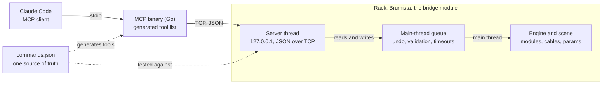

# W72 — Technical Foundations

2026-11-01

## At a glance

W72's first deliverable is a Rack module and a small MCP binary, built from one repo and one command list.



Every command that touches the engine or the scene, read or write, is queued and run on Rack's main thread, where undo and validation happen. Only commands that read plugin data, which doesn't change while Rack runs, answer straight from the server thread.

## Repository and sync

One GitHub repository, `w72-rack-plugin`, holds the plugin, the MCP binary and the protocol definition, released together under one version number. The plugin sits at the repo root, because the VCV Library builds a plugin from its repository at a given commit and has no setting for a subfolder.

```
w72-rack-plugin/
  plugin.json             the Rack plugin, slug W72
  Makefile
  src/                    C++: the bridge module, later the sound modules
  res/                    panels (SVG), generated
  panels/                 one description per panel
  tools/panelgen/         the panel generator, Go (not in the plugin package)
  mcp/                    the MCP server, Go (not in the plugin package)
  protocol/
    commands.json         every command: name, parameters, description
    protocol.go           embeds commands.json for the Go code
    limen/commands.json   limen's commands, the parity oracle
  docs/
    concept.md
    architecture.md       this document
    design-system.md      the panel style
    modules/              one page per module; each module's manualUrl
  CLAUDE.md               what every Claude Code thread reads first
```

The sync procedure keeps the two artifacts from drifting:

1. **One source of truth.** `protocol/commands.json` lists every command. The Go server generates its MCP tool list from it. The C++ dispatch table is handwritten and checked against it by `tools/check-commands.sh` in CI: the same commands, in the same order, on the same thread. `hello` builds its command list from that table, so a live `hello` agrees with the file too. Generating the C++ is a fallback if drift becomes a problem. Adding a command is one edit, and a mismatch fails the test.
2. **One version, semver.** `plugin.json`'s version, the binary's version and the protocol version move together under Semantic Versioning. Rack pins the major version to its own (2.x for Rack 2), so new commands or modules are minor bumps and fixes are patches. A release tags all three.
3. **A version handshake.** The module's `hello` reports its protocol version. The binary refuses a version it doesn't know, or warns, so an old pair says so instead of half working.
4. **Separate distribution.** The plugin goes through the VCV Library; the binary ships as prebuilt files on GitHub Releases, built by GitHub Actions. This is how forsitan modulare does it ([limen-tools](https://github.com/gosub/limen-tools/releases)). The Library has no written rule on executables inside a plugin, but it builds plugins from source with a C++ toolchain, and macOS would likely block an unsigned executable.

## The bridge module

Brumista is a TCP server inside Rack. Commands that touch the patch run on Rack's main thread; only plugin and model lists answer from the server thread. limen has the same shape: one file of about 1,165 lines (`src/limen.cpp` in forsitan modulare `master-v2`), with no DSP.

- **Server thread.** Listens on `127.0.0.1` only, one client at a time, with one JSON object per line. It polls its sockets every 100 ms so it can stop cleanly; on Linux, closing a socket from another thread doesn't reliably wake it. Sends never raise `SIGPIPE`, so a client that hangs up can't take Rack down. If the port is taken (a second Brumista), it retries every second.
- **Main-thread queue.** Anything that touches the engine or the scene, reads included, is queued as a function and run in the module widget's `step()`. Reading from the server thread races with the main thread removing a module. The server thread waits 2 s for the result.
- **Timeouts cancel.** A command still queued when the wait ends is cancelled and never runs, so a client told "timeout" can trust nothing happened. One the main thread has already started is waited for until it finishes. limen leaves timed-out work in the queue to run later.
- **Port.** 7200 by default, not limen's 7000, so both modules can sit in one patch while W72 is being built.
- **Cables as Rack makes them.** Every new `CableWidget` gets a colour: the requested one, or `RackWidget::getNextCableColor()`. limen does the same since forsitan 2.17.1; before that it set none, which left Rack's default of transparent black ([forsitan-modulare#24](https://github.com/gosub/forsitan-modulare/issues/24)).
- **Undo.** Each write records one Rack history step (cable add or remove, module add, move or remove, parameter change), so Ctrl+Z works on Claude's edits. Writes record through one function, which a batch points at a `ComplexAction` so the whole batch is one step. `remove_module` calls Rack's own Delete, which pushes its step itself; inside a batch it is taken back off the history into the group.
- **A batch is one main-thread task.** `batch` runs all its commands in a single queued function, so no frame falls between them and a client sees the patch only before or after. The 2 s wait covers the batch's start; the MCP binary allows 30 s for its reply. limen runs a batch on the server thread and sends each write to the main thread on its own.
- **Saving as Rack's menu saves.** `save_patch` without a path is Rack's Save; `save_patch_as` is Save as, which makes the file the patch's own and adds it to the recent patches. Both mark the patch saved before writing, as Rack does, so the file doesn't carry Rack's unsaved mark. `save_patch` with a path writes a copy and leaves the patch's file and unsaved state alone. Any explicit path must be absolute, in a folder that exists, and gets `.vcv` when it lacks it; an existing file is replaced only when the call sets `overwrite`. limen overwrites silently and leaves the patch marked unsaved. Saves get the MCP binary's 30 s reply window, as a batch does.
- **The view isn't the patch.** `set_fullscreen` and `zoom_to_modules` change the window and the view, not the patch, so they record no undo step. Both run on the main thread, which owns the window and the widgets: `zoom_to_modules` calls Rack's own F4 before replying and again in the next two frames, from Brumista's widget `step()`. A single call sets the zoom but leaves the offset clamped against the old view, so the modules land off screen; limen repeats it over three frames for the same reason.
- **Reading state on the main thread.** `list_params`, `list_ports` and `get_module_data` read per module, in the main-thread task, as Rack's tooltips do: a read takes no engine lock, so the audio thread never waits on it. A param's `display` is the module's own `getDisplayValueString()` plus its unit, from the `ParamQuantity`, so it shows a smoothed knob's target, as the tooltip does; `value` stays the engine's raw value. A port's channel count is read once and capped at 16 before its voltages, since the engine writes the two apart. Voltages are instant samples; anything faster waits for windowed statistics in Measuring. `get_module_data` returns the module's `dataToJson()`, the `data` a patch file holds for it.
- **Parameters as a knob sets them.** `set_param` goes through the `ParamQuantity`, which clamps to the range and rounds stepped parameters, and replies with the value that resulted.
- **Validate before acting.** Port indices are checked against what the panel actually exposes, and every command is wrapped so an exception becomes an error reply instead of a Rack crash. Through limen, a cable to a port with no panel jack (on NYSTHI Programmer) took Rack down: Rack's `CableWidget::setCable` throws once the engine already holds the cable. Arguments, placement mode included, are checked before anything changes. Brumista refuses to remove a Brumista module, since its commands run inside that widget's `step()`.

## Features and milestones

The first milestone matches what limen does today, without its problems. Each later one adds a capability limen doesn't have. limen's surface (forsitan 2.17.2, protocol 2) is captured in `protocol/limen/commands.json`: each command's params, result shape and error strings, plus the problems Brumista must not repeat.

1. **Parity, done properly.** `hello`, list modules, params, ports and cables, add, move and remove modules, set params, add and remove cables, batch, save as. Plus cable colours, undo history and validation from the start.
    - Done when: a full patch section can be built end to end, with cables in the requested colours.
    - The commands still missing after the read-only ones ship in four groups, in order:
        1. Patch edits: `set_param`, `add_module`, `remove_module`, `move_module`, `add_cable`, `remove_cable`, each with its undo step.
        2. `batch`, built on group 1. A whole batch undoes as one step.
        3. Saving: `save_patch` and `save_patch_as`. Neither replaces an existing file unless the call asks for it.
        4. View: `set_fullscreen` and `zoom_to_modules`, last or alongside saving.
    - `quit` stays out: it closes Rack with no save prompt.
2. **Seeing state.** Read what a module shows: parameter values with labels, units and display strings, and instant port voltages with channel counts. Then a module's JSON state read live (`dataToJson`), for what the panel doesn't show. Reads stay per module, so a reply stays small.
    - Done when: a quantizer's output voltage and a mixer's gain trims, as the panel displays them, can be read from a running patch, and so can a quantizer's scale mask.
3. **Seeing the rack.** Take a screenshot of a module or the whole rack, rendered in process. It comes right after the state reads because it fills the gaps they leave: moving signals, displays drawn by the widget, lights, layout.
    - Done when: Claude can look at a panel without you taking a screenshot.
4. **Building blocks.** Load a `.vcvm` preset into a module and add a `.vcvs` selection at a position. Stoermelder PackOne (8FACE, STRIP) is the prior art. Also set a cable's colour after the fact, with its undo step.
    - Done when: a saved selection can be dropped into a patch by name.
5. **Measuring.** Keep windowed voltage statistics (min, max, mean) taken in `process()`, so nothing between two reads is missed.
    - Done when: Claude can check that a quantizer output moves, or that a poly cable carries four channels, without asking you to listen.
6. **Opening patches.** Open a patch. It replaces the whole scene, so it refuses to run over an unsaved patch unless the call says so.
    - Done when: Claude can switch to a saved patch without losing unsaved work by accident.

Sound modules (Ghisa, Scighera, Gibigiana) come after milestone 1 at the earliest. Their specs come from technique cards.

## The MCP binary

The MCP server is a small Go program that speaks MCP over stdio to the client and the module's protocol over TCP to Rack. Users download one executable; nothing else to install.

- **Why Go.** One static executable, no runtime. It cross-compiles to Windows, Linux and macOS by setting `GOOS` and `GOARCH`. There's an official MCP SDK (`modelcontextprotocol/go-sdk`). Python was ruled out because users would have to install it.
- **Its job is thin.** Generate the tool list from `protocol/commands.json`, forward each call to the module, return the reply. No patch logic lives in the binary.
- **Its name.** The MCP server takes the bridge module's name, Brumista, which becomes the tools' prefix (`mcp__brumista__add_cable`).
- **Its tools.** One tool per command in `protocol/commands.json`, with the same name, description and parameters. `protocol/` is a small Go module that embeds the file, so the binary reads the one source of truth rather than a copy. A tool call returns the command's `result` as JSON text; an error reply or a failed connection comes back as a tool error the model can read.
- **One connection per call.** Each call connects, sends `hello`, sends the command and closes. Brumista serves one client at a time, so a held connection would lock out every other client. Calls from one binary run one at a time, since Brumista's listen backlog is 1 and a burst of parallel connections is refused.
- **The handshake.** The binary refuses a server whose `hello` doesn't name Brumista (limen answers `hello` too) and a module on another major version. Any other version mismatch works, with a warning on stderr.
- **Configuration.** `-host` and `-port`, defaulting to `127.0.0.1` and `7200`. Registered in Claude Code with `claude mcp add brumista -- <path>/brumista-mcp`.
- **Releases.** Pushing a tag `vX.Y.Z` that matches `plugin.json` runs `.github/workflows/release.yml`, which builds `brumista-mcp-X.Y.Z-<os>-<arch>` for Windows, Linux and macOS and publishes them, with `SHA256SUMS`, as a GitHub Release. `mcp/version.go` holds the version; a test checks it against `plugin.json`.
- **The one-artifact alternative.** The module could serve MCP over HTTP itself (localhost only, an `Origin` check and a token). That's kept in reserve, since two artifacts with a sync procedure are acceptable.

## Toolchain and build

The plugin builds natively on Windows with MSYS2 (MinGW64) and the Rack SDK, VCV's documented setup.

| Piece | What it is |
| --- | --- |
| MSYS2 (MinGW64) | Compiler, `make` and shell, installed with one `pacman` line |
| Rack SDK | Zip of headers and build files matching the Rack version (`Rack-SDK-2.x-win-x64`); `RACK_DIR` points at it |
| Go | Builds the MCP binary for all platforms |

The build loop:

1. Close Rack, since Windows locks a loaded plugin `.dll`.
2. `make install` at the repo root, which builds and copies the plugin into Rack's user `plugins-win-x64/` folder.
3. Start Rack and test.

Cross-compiling from Linux (VCV's `rack-plugin-toolchain`, or mingw-w64 with the `-posix` g++) is the alternative. It's worth it only to check Linux and macOS builds before a Library submission, and the Library builds those itself.

Changes land through pull requests with Conventional Commits messages. A lightweight GitHub Actions CI is planned once there is code: build and test the Go server, check `commands.json` against both sides, and compile the plugin on Linux against the Rack SDK. Release builds of the binary come from the same Actions setup.

## Where work runs

Development runs as a Claude Code Project: a coordinator plus threads. Work that needs Rack or the Windows build runs in local threads on the development machine, and everything else can run in the cloud.

| Work | Thread | Why |
| --- | --- | --- |
| Design, specs, docs, reviews | Cloud | Needs only the repo |
| Go MCP binary: code, tests, cross-builds | Cloud | Builds anywhere |
| C++ code that a compile check can verify | Cloud | A Linux compile catches most errors |
| Windows build and `make install` | Local (Remote Control) | Needs MSYS2 and the Rack folder |
| Live tests against a running Rack | Local (Remote Control) | Needs Rack, limen and rackmaster |

## How the project uses rackmaster

rackmaster, a Claude Code plugin for VCV Rack, is the project's main source of context: a local index of installed modules with manuals, technique cards and errata. Every thread checks it before writing code that something else may already do.

| Part | Used for |
| --- | --- |
| Module index | Name and slug collisions; gap checks, so sound modules fill gaps instead of adding a twenty-first shimmer |
| Manuals and source | Prior art: Stoermelder PackOne for presets and module state; Plateau for reverb structure; existing shift registers for Ghisa |
| Technique cards | Specs for sound modules; the patches they were found in become test patches |
| Errata and conventions | A checklist of mistakes not to repeat |

Errata that become rules for W72:

- **Refuse cables to hidden ports**, from the NYSTHI Programmer crash.
- **Declare ports in enum order**, from Cella Resonators, whose port ids disagree with its declaration order.
- **Show momentary state**, from Dopamine's Record param, which reads 0 at rest.
- **Expose real state to the patch**, from quantizers whose scale mask is invisible to parameters.

W72 modules also get rackmaster manuals from the start, written next to the code.

## Licence and naming

The plugin and the MCP binary are GPL-3.0-or-later. That allows reusing limen, limen-tools and Stoermelder code, which are all GPL-3, and it's the licence VCV recommends.

- **Slugs:** plugin `W72`. Module slugs in plain ASCII, permanent once a patch uses them.
- **No "VCV"** in any name, slug or binary name.
- **The binary's name** follows the bridge module, for example `brumista-mcp`.
- **Naming grammar and glossary:** in [concept.md](concept.md).

## Decisions

| Decision | Date |
| --- | --- |
| Repo `w72-rack-plugin`; plugin slug and name `W72` | 2026-11-01 |
| Port 7200; the MCP server takes the bridge module's name | 2026-11-01 |
| `commands.json` is a test oracle; generate only if drift becomes a problem | 2026-11-01 |
| No executable in `res/`; the binary ships on GitHub Releases | 2026-11-01 |
| Plugin at the repo root, so the Library can build it | 2026-11-01 |
| Milestones: parity, seeing state, building blocks, measuring, seeing the rack | 2026-11-01 |
| Milestones reordered: parity, seeing state (values, voltages), seeing the rack (screenshots), building blocks, measuring (windowed statistics); `dataToJson` joins seeing state, cable colour edits join building blocks, opening a patch comes last | 2026-11-02 |
| GPL-3.0-or-later for plugin and binary | 2026-11-01 |
| Pull requests for every change; Conventional Commits | 2026-11-01 |
| Semantic Versioning, one version for plugin, binary and protocol (`2.MINOR.PATCH`) | 2026-11-01 |
| Lightweight GitHub Actions CI once there is code | 2026-11-01 |
| The bridge module is Brumista (slug `Brumista`); the MCP server takes the same name | 2026-11-01 |
| Panels are dark only; the W72 mark is the only element taken from the W72 web design system | 2026-11-01 |
| Panel style Metropolitana: a family-coloured band, Inter Tight outlines, a light output plate ([design-system.md](design-system.md)) | 2026-11-01 |
| Panel design is decided on a Claude Design canvas; panel SVGs are built by a generator in the repo | 2026-11-01 |
| The panel generator is written in Go | 2026-11-01 |
| Panel descriptions place controls by row (counted from the bottom) and order, never by coordinate | 2026-11-01 |
| Control positions reach the C++ through a generated `src/<Slug>Panel.hpp`, not a hidden SVG layer | 2026-11-01 |
| Static Inter Tight files (OFL) live in `tools/panelgen/fonts/`, outside the plugin package | 2026-11-01 |
| limen's command surface is captured in `protocol/limen/commands.json` as the parity oracle, apart from W72's own `protocol/commands.json` | 2026-11-01 |
| Every command that touches the engine or the scene runs on the main thread, reads included | 2026-11-01 |
| A command that times out before the main thread starts it is cancelled and never runs | 2026-11-01 |
| `hello` reports `server` and the semver `version`, not an integer protocol number | 2026-11-01 |
| The MCP binary uses the official Go SDK (`modelcontextprotocol/go-sdk`) and embeds `commands.json` through a `protocol` Go module | 2026-11-01 |
| The MCP binary opens one connection per call and runs its calls one at a time | 2026-11-01 |
| Release binaries are plain executables per platform, published by a tag-triggered workflow | 2026-11-01 |
| The first release is v2.1.0, tagged when Brumista reaches parity with limen (milestone 1) | 2026-11-01 |
| The remaining parity commands ship in four groups: patch edits, batch, saving, view; `quit` is left out | 2026-11-01 |
| A whole `batch` undoes as one step; writes record undo through one function a batch can group | 2026-11-01 |
| `save_patch_as` refuses to overwrite an existing file unless the call asks for it | 2026-11-01 |
| A `save_patch` copy follows the same rule: an explicit path never replaces a file unless `overwrite` is true | 2026-11-01 |
| Saves follow Rack's menu: the patch is marked saved, paths must be absolute and get `.vcv` when missing | 2026-11-01 |
| `set_param` clamps and snaps through the `ParamQuantity` and replies with the resulting parameter | 2026-11-01 |
| A cable with no colour takes Rack's next cable colour; choosing colours by signal is the caller's job | 2026-11-01 |
| `remove_module` goes through Rack's Delete, and refuses a Brumista module | 2026-11-01 |
| `batch` runs as one main-thread task and keeps limen's reply shape; commands that ran before a failure stay done and undo together | 2026-11-01 |
| `set_fullscreen` and `zoom_to_modules` run on the main thread and record no undo step; zooming is Rack's F4, repeated over three frames as limen does | 2026-11-01 |
| Each module has a page in `docs/modules/`, and its `manualUrl` in `plugin.json` points to that page on `main` | 2026-11-02 |
| Seeing state extends `list_params` (`default`, `display`, switch `labels`) and `list_ports` (`channels`, instant `voltages`, always an array) with new fields only, and adds `get_module_data` for `dataToJson`; all per module, on the main thread | 2026-11-02 |
| Display readouts are signage text (Inter Tight SemiBold) drawn live with NanoVG on the light layer; that one weight ships in `res/fonts/` | 2026-11-02 |
| Display ink is white; a highlight colour stays open until a module needs one | 2026-11-02 |
| A quantizer's scale shows as a twelve-light keyboard; rows of states use flat bar lights; single states keep stock round lights | 2026-11-02 |
| A readout takes one 48 px grid row | 2026-11-02 |
| Ghisa is a 16-stage shift register with a drawn tap shape (8 buttons) that a DEPTH knob and CV slide through the register; it has no quantizer | 2026-11-02 |
| Ghisa's shape and DEPTH changes take effect on the next clock | 2026-11-02 |
| Ghisa builds in the bass tap (`bss`'s job): a BASS output beside the poly CHORD | 2026-11-02 |
| A module's working modes go in its right-click menu, not on the panel | 2026-11-02 |
| Ghisa's HOLD is a button and a gate input; while either is on, stage 16 feeds stage 1, so the loop is always 16 clocks | 2026-11-02 |
| Ghisa's default shape is buttons 1, 3 and 6 | 2026-11-02 |
| Ghisa has a poly CHANGE output: per voice, a trigger when that voice's note moved | 2026-11-02 |
| Ghisa's panel: register display under the band, shape buttons as an unnumbered 2 × 4 grid at 2 HP pitch; rows above the inputs may sit off the 48 px grid | 2026-11-02 |

## Open questions

None for now.
