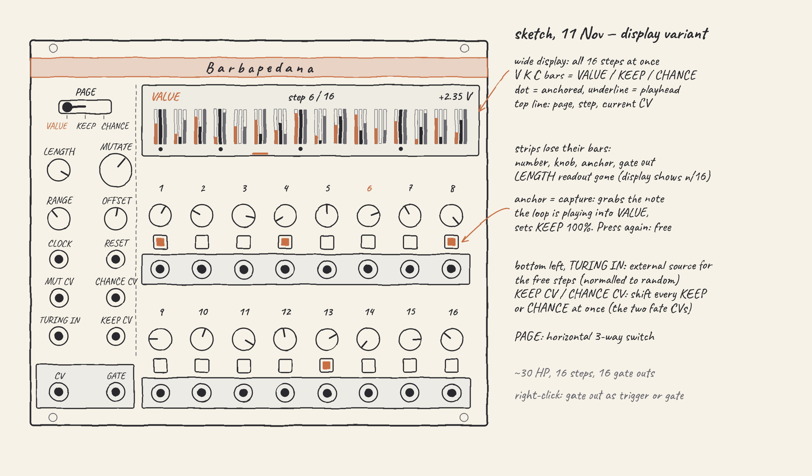

# Barbapedana

*The Milanese street singer of the 1800s, remembered in the song that carries his name: familiar tunes, verses of his own.*

> **Designed, not built.** This page is the design. It becomes the manual when Barbapedana ships, and gets its `manualUrl` then.

Barbapedana is a 16-step sequencer crossed with a Turing-style random loop. Every step has a value you program and a KEEP chance: at 100% the step always plays your value, at 0% it always plays the random loop, and in between a coin decides on each pass. An anchor button on each step makes it yours, and pressed while the loop is playing it captures the loop's note into the step's knob. The machine improvises, and you keep the phrases you like.

- **Family:** trades · **Width:** about 30 HP · **Slug:** `Barbapedana` · **Since:** not released

## Why

Melodies in the saved patches come from random loops and a quantizer far more often than from programmed steps: OrangeLine Mother is in 62 of 182 patches, SickoCV RandLoops8, Vult Dopamine and OrangeLine Morph follow, while plain step sequencers appear in a handful (Fundamental SEQ3 in 5, Impromptu Gate-Seq-64 in 6). The random loops wander with nothing to hold on to, and the step sequencers don't wander at all.

OrangeLine Morph and Morpheus come closest: they morph between a stored sequence and a random one, with a LOCK chance. But LOCK is one dial for the whole loop. There is no way to say that steps 1, 4 and 8 are always the ones you programmed while the rest are free. Barbapedana puts that chance on every step.

## Prior art

| Module | What it does | How Barbapedana differs |
| --- | --- | --- |
| OrangeLine Morph / Morpheus | Morphs between a given or stored sequence and a random one, one LOCK chance for the loop | KEEP per step, anchors, and capture into the knobs |
| Bruer SEQ1 | Probabilistic Turing sequencer with a quantizer and Euclidean triggers | Programmed steps beside the loop; no quantizer |
| Animatek UZZ, Count Modula Multi-step | 16 steps with a probability per step | The probability chooses between your value and the loop, besides firing the gate |
| OhmerPrems FranKe | Multi-track step sequencer with Turing machines inside | One line where each step is part yours, part the loop's |
| InfiniteNoise Turing Machine | Turing machine with 16 gate outputs | Gate outputs per step, on a sequence you can program |
| SickoCV RandLoops8, Grayscale Permutation | Turing-style looping random voltages | A program to hold the loop against |

## How it works

- **Steps.** 16 steps, each with VALUE, KEEP and CHANCE. LENGTH sets how many steps play (1 to 16). CLOCK advances, RESET returns to step 1.
- **The random loop.** Behind the steps runs a Turing-style loop of 16 values. On each pass, MUTATE is the chance that a free step's loop value is redrawn, so fully left the loop repeats and further right it keeps changing. What a redraw does is the *Loop draws* menu item: **Walk** (the default) lands near the step's old value, within about an eighth of the span either way, so the loop drifts instead of jumping; **Anywhere** draws across the whole span; **Turing bits** runs a 16-bit shift register read as values, so a redraw flips a bit and neighbouring steps stay related. TURING IN, when patched, overrides all three: a redrawn value is sampled from the input instead.
- **KEEP.** On each step, a coin with the step's KEEP chance decides whether it plays VALUE or the loop's value. KEEP CV shifts every step's KEEP at once.
- **Anchors.** An anchored step always plays VALUE, whatever KEEP or KEEP CV say. Pressing the anchor on a free step captures the value the loop is playing into VALUE, so the knob turns to it, and locks the step; pressing it again frees the step. A capture is one Ctrl+Z. The anchor never touches KEEP: it is an override on top of it, so a released step goes back to the KEEP its knob was showing all along.
- **CHANCE.** The chance that the step fires its gate, on its own output and on GATE. CHANCE CV shifts every step's CHANCE at once, so KEEP CV and CHANCE CV are the two global "how much fate" controls.
- **Pages.** The 16 knobs edit one thing at a time: the PAGE switch picks VALUE, KEEP or CHANCE. Each page has its own 16 parameters and PAGE only shows one set, so the knobs show the stored values of the page you're on, and undo, Randomize, presets, MIDI mappings and Brumista all see stable parameters (KEEP 5 is always KEEP 5).
- **Values and the CV.** VALUE and the loop share one 0 to 1 space, so a capture is a plain copy. CV out is OFFSET + value × RANGE: RANGE spans 0 to 10 V (default 2 V, two octaves), OFFSET runs from −5 to +5 V (default 0). Since the steps are fractions of the span, turning RANGE squeezes or stretches the whole line, steps and loop together. VALUE's tooltip shows the volts the step will send. No quantizer: one goes downstream.
- **Silent steps.** CV only moves when a gate fires, so a note's release tail never jumps in pitch; *CV on silent steps* in the menu can make it move on every step instead, for CV used as modulation.
- **Gates.** By default each gate lasts half a step, measured from the clock, so two firing steps in a row stay two notes; *Gate outputs* in the menu switches to 1 ms triggers.

## Inputs and outputs

| Jack | Does |
| --- | --- |
| CLOCK, RESET | Advance one step; return to step 1 |
| MUT CV | Adds to MUTATE |
| CHANCE CV | Shifts every step's CHANCE |
| TURING IN | Source for the loop's redrawn values, normalled to the internal random |
| KEEP CV | Shifts every free step's KEEP |
| CV | The current step's value, scaled by RANGE and OFFSET; holds through silent steps by default |
| GATE | The current step's gate, when its CHANCE coin passes |
| 1 to 16 | Each step's own gate |

## Right-click menu

| Item | Choices | Default |
| --- | --- | --- |
| Gate outputs | Gate (half a step) or trigger (1 ms) | Gate |
| CV on silent steps | Hold or move | Hold |
| Loop draws | Walk, anywhere or Turing bits | Walk |

## Panel

A hand-drawn sketch, not a mock: the real panel comes from the generator once the layout is settled on the grid.

- **Left column:** PAGE (a horizontal three-way switch: VALUE, KEEP, CHANCE), LENGTH and MUTATE, RANGE and OFFSET, CLOCK and RESET, MUT CV and CHANCE CV, TURING IN and KEEP CV, then CV and GATE on the plate.
- **A wide display** over the steps, following the PAGE switch. Its top line shows the page, the step and LENGTH (`step 6 / 16`) and the CV going out. On the VALUE page each step shows your value as a solid bar and the loop's value at that step as an outline, so you can see what an anchor would capture; on KEEP and CHANCE, one bar per step, the value its knob is editing. Anchored steps get a dot and the playhead a line underneath on every page. It replaces a LENGTH readout. (The sketch predates this and still draws all three pages at once.)
- **Two rows of eight steps**, each a number, the page knob, the anchor button and its gate output on a plate. The second row's plate lines up with the CV/GATE plate.

## Open questions

- [ ] Relative steps (each step a move from the last note), set aside for later.
