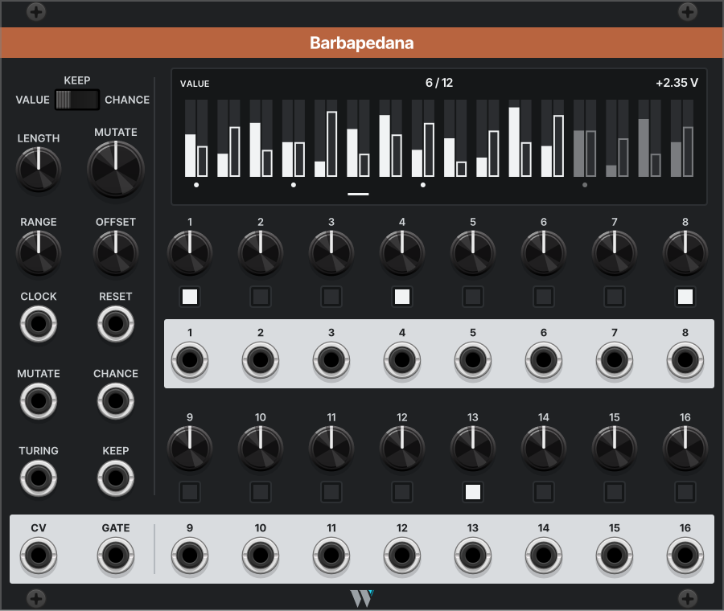

# Barbapedana

*A 16-step sequencer crossed with a random loop: each step is yours by a chance you set, and anchors capture the loop's notes.*

## What it does

Barbapedana is a 16-step sequencer with a Turing-style random loop running behind the steps. Every step has a value you program and a KEEP chance. At 100% the step always plays your value, at 0% it always plays the loop, and in between a coin decides on each pass. MUTATE sets how often the loop rewrites itself, so it can repeat like a phrase or keep wandering.

Each step has an anchor button. An anchored step always plays your value, whatever KEEP says. Press the anchor while the loop is playing a note you like, and the step's knob turns to that note and locks it. The machine improvises, and you keep the phrases you like.

Each step also has a CHANCE, the chance it fires its gate, and a gate output of its own. Barbapedana has no quantizer: RANGE and OFFSET set the span of the CV, and a quantizer goes downstream.

Barbapedana is 30 HP wide. It needs a clock in CLOCK.

## The panel

The column on the left holds what every step shares. On the right are the display and the 16 steps, in two rows of eight.

| Control | What it does |
| --- | --- |
| PAGE | What the 16 step knobs edit: VALUE, KEEP or CHANCE. Each page keeps its own knobs, so switching pages never changes a setting. |
| LENGTH | How many steps play, 1 to 16. |
| MUTATE | How often the loop rewrites a free step. Fully left, the loop repeats. |
| RANGE | The span of the CV, 0 to 10 V. The default, 2 V, is two octaves. |
| OFFSET | Where the span starts, −5 to +5 V. |
| CLOCK | Advances one step. Required. |
| RESET | The next clock plays step 1. |
| MUTATE input | CV added to MUTATE. |
| CHANCE input | CV that adds to or takes from every step's CHANCE at once. |
| TURING | Optional. Patched, the loop takes its new notes from this input instead of making them up. |
| KEEP input | CV that adds to or takes from every step's KEEP at once. Anchored steps ignore it. |
| CV | The note playing. It moves only when a gate fires, so a release tail never jumps in pitch. |
| GATE | The gate of every step that fires. |

The display follows PAGE. Its top line shows the page, the step playing over LENGTH and the CV going out. On VALUE each step shows your value as a solid bar and the loop's value beside it as an outline, which is what its anchor would capture. On KEEP and CHANCE it shows one bar per knob. Anchored steps have a dot underneath, the playing step has a line, and steps past LENGTH are dim.

Each step, numbered 1 to 16:

| Control | What it does |
| --- | --- |
| Knob | The step's VALUE, KEEP or CHANCE, whichever PAGE shows. VALUE's tooltip shows the volts the step sends. |
| Anchor | Lit, the step always plays its VALUE. Pressed on a free step, it captures the loop's note into VALUE and locks it; pressed again, it frees the step. Either is one Ctrl+Z. |
| Output | The step's own gate, when it plays and its CHANCE lets it fire. |

## Right-click options

The defaults are fine to leave alone.

| Option | What it does | Default |
| --- | --- | --- |
| Gate outputs | Gate (half a step) or trigger (1 ms). | Gate |
| CV on silent steps | Hold keeps the last note's CV through steps that don't fire. Move follows every step, for CV used as modulation. | Hold |
| Loop draws | How the loop makes a new note. Walk lands near the old one, so the loop drifts. Anywhere draws across the whole span. Turing bits runs a 16-bit shift register, so neighbouring steps stay related. A patched TURING input overrides all three. | Walk |

## Samples

### Start here: catch a phrase

1. Add Barbapedana and VCV's LFO, VCO, ADSR, VCA, Quantizer and Audio.
2. Patch the LFO's square into **CLOCK**, Barbapedana's **CV** through the Quantizer into the VCO's V/Oct, and **GATE** into the ADSR's gate. Run the VCO through the VCA, with the ADSR on its CV, into Audio.
3. Every KEEP starts at 0%, so you are hearing the loop. Turn **MUTATE** fully left and it repeats.
4. When a step plays a note you like, press its anchor. Its knob turns to that note, and the dot on the display says it's yours.
5. Turn **MUTATE** up to about a third. The free steps wander while the anchored ones hold the phrase together.

### More ideas

**Program, then let go.** Set the VALUE page by hand, put every KEEP at 100%, then pull a few steps down to 50%. The line keeps its shape and changes a note here and there.

**Fate on a fader.** An envelope or a slow LFO into **KEEP**: up, the line plays your program; down, the loop takes over the free steps.

**Rhythm too.** On the CHANCE page, set the off-beats low. **CHANCE** CV then thins or fills the line.

**Drums from the steps.** The step outputs each fire their own gate. Patch a few into drum voices and the melody's rhythm drives them.

**Borrow a loop.** Patch another random source, or a melody, into **TURING**. Each new note the loop draws is sampled from it.

**When nothing plays.** Barbapedana needs a clock in CLOCK. If the steps advance but the gate is silent, check the CHANCE page.

<!-- Sample patch to come: built in Rack with VCV Fundamental modules only, saved to patches/. -->

## Where it comes from

<!-- Photo to come: Barbapedana, the Milanese street singer, public domain or CC-licensed, with its credit. -->

*Barbapedana: the Milanese street singer of the 1800s, remembered in the song that carries his name: familiar tunes, verses of his own.*

Melodies in my patches come from random loops and a quantizer far more often than from programmed steps: OrangeLine Mother is in 62 of 182 patches, SickoCV RandLoops8, Vult Dopamine and OrangeLine Morph follow, while plain step sequencers show up in a handful. The random loops wander with nothing to hold on to, and the step sequencers don't wander at all.

OrangeLine Morph and Morpheus come closest: they morph between a stored sequence and a random one, with a LOCK chance. But LOCK is one dial for the whole loop. There is no way to say that steps 1, 4 and 8 are always the ones I programmed while the rest are free. Barbapedana puts that chance on every step, and the anchors catch the notes the loop throws.

Bruer SEQ1 is a Turing sequencer with a quantizer and Euclidean triggers. Animatek UZZ and Count Modula Multi-step have a probability per step, but it only fires the gate. OhmerPrems FranKe puts Turing machines inside a step sequencer, InfiniteNoise's Turing Machine has 16 gate outputs, and SickoCV RandLoops8 and Grayscale Permutation loop random voltages. None of them has a program to hold the loop against.

Timing details, edge cases and the saved state are in the [reference](barbapedana-reference.md).
