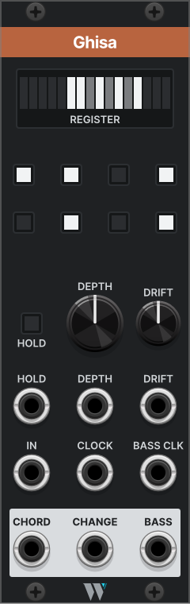

# Ghisa

*The Milanese traffic warden: it stands in the stream of notes and sends each one where the chord needs it.*

Ghisa is a shift register whose taps are a control. Each clock pushes the input's voltage into a 16-stage register. A shape of up to eight stages, drawn with buttons, reads the register into a polyphonic CHORD, and DEPTH slides that shape back through the register, so the same voicing reads from older memory. BASS gives one note of the chord for a bass voice, and CHANGE tells each voice when its note has moved.

Fed a quantized melody, Ghisa makes the chord from what the melody just played.

- **Family:** trades · **Width:** 8 HP · **Slug:** `Ghisa` · **Since:** 2.3.0

## Getting started

1. Patch a quantized melody into **IN** and its clock into **CLOCK**. Ghisa has no quantizer: the one upstream decides the harmony, and every tap stays in its scale.
2. Patch **CHORD** into the V/Oct input of a polyphonic voice. A fresh Ghisa taps stages 1, 3 and 6 (now, two clocks ago and five clocks ago), so the chord has three notes.
3. Patch **CHANGE** into that voice's envelope, in place of the clock. Each voice now sounds only on the clocks where its note moves, and a note the next chord keeps goes on ringing. If the envelope reads a gate rather than a trigger, set *Change* to *Gate until next clock* in the right-click menu.
4. Patch **BASS** into a mono voice for a bass under the chord. To have the bass move slower than the chord, on the beat or once a bar, patch that slower clock into **BASS CLK**.

Then press the shape buttons to change the voicing, and turn DEPTH to read the same shape from further back.

## Panel

| Control | What it does |
| --- | --- |
| REGISTER display | Sixteen bars, one per stage, newest at the left. Off: outside the window. Dim: in the window, not tapped. Full: tapped. It shows the chord that is sounding, so the voicing can be watched moving. |
| Shape buttons | Eight latching buttons in a 2 × 4 grid, read left to right and top to bottom. Button *k* lit taps the *k*-th stage of the window. A button lights as soon as it's pressed; the chord follows on the next clock. |
| DEPTH | Where the window starts, from 0 to 8 stages back. At 0 the window is stages 1 to 8; at 8 it is stages 9 to 16. |
| HOLD | Loops the register (see below). Lit while it loops, by the button or the gate. |
| IN | The voltage to record. Any voltage: pitch, modulation or slow CV. Reads the first channel. |
| CLOCK | Each rising edge shifts the register and updates every output (BASS too, unless BASS CLK is patched). |
| DEPTH (input) | Adds to the knob, 1.25 V per stage, so 0 to 10 V covers the range. The sum is rounded to a whole stage and clamped to 0 to 8, so a negative CV holds DEPTH at the knob's floor. |
| HOLD (input) | A gate: while it's high, the register loops. |
| BASS CLK | BASS's own clock, normalled to CLOCK. Unpatched, BASS moves with the chord. Patched, BASS changes only on its rising edges and holds in between (see below). |
| CHORD | Poly: one channel per lit button, holding that tap's voltage, folded into the *Chord range* if one is set. |
| CHANGE | Poly: one channel per CHORD channel, firing on a clock when that channel's note changed. |
| BASS | One voltage from the tapped stages, chosen by the *Bass* mode. |

In the module browser the panel shows a sample: the shape 1·2·4·6·8 at DEPTH 5.

## How it works

- **The register.** On each rising edge at CLOCK, every stage passes its voltage one stage down and stage 1 samples IN. Stage 1 is the newest; stage 16 is sixteen clocks old.
- **Everything lands on the clock.** A new shape, a new DEPTH and a new menu choice all take effect at the next clock, together with the shift, so the chord only ever changes in time.
- **BASS CLK.** With a clock patched here, BASS is read only on its rising edges, from the chord that is sounding at that moment, and held until the next one; the *Bass* and *Bass octave* choices wait for that edge too. A bass edge that lands on a main clock reads after the shift, so the bass names the chord that starts with it. Every cable in Rack delays a signal by one sample, so a main clock that arrives up to 1 ms after the bass edge counts as the same edge: BASS reads again after that shift. A bass voice triggered by the same bass clock may hear the old note for that sample or two.
- **HOLD.** While the button is on or the HOLD gate is high, each clock feeds stage 16 back into stage 1 instead of sampling IN. The register loops its last 16 values and the chord repeats every 16 clocks, whatever the shape or DEPTH.
- **Chord range.** With a range set, each tap is moved by whole octaves into the window, one or two octaves wide from the C it names. Every tap keeps its pitch class, so a wide melody gives a close voicing, with inversions as the taps move. *By pitch* orders the notes after the fold, so channel *n* is the *n*-th lowest note that sounds. Two taps an octave apart fold onto the same note. BASS reads the taps before the fold, so *Lowest* is still the melody's real low note; *Bass octave* keeps it in a bass register.
- **CHANGE.** On a clock, a channel fires when its voltage moved by more than 1 mV, or when it is new because the shape grew. Channels are compared as they leave CHORD: with *Chord order* set to pitch, a channel follows the *n*-th lowest note, and with a *Chord range* set, a tap that jumps by exactly an octave lands on the same note and doesn't strike its voice again.
- **An empty shape.** With no button lit, CHORD carries one channel at 0 V and CHANGE stays low: Rack keeps a patched output at one channel at least.
- **Saved with the patch.** The register and the menu choices are saved, so a patch reopens with the chord it closed on.

## Right-click menu

| Item | Choices | Default |
| --- | --- | --- |
| Bass | *Lowest*: the lowest tapped voltage. *Root*: the tap that best explains the others as a chord built on it (thirds and fifths above it), scored as cvly `bss`'s Harmonic mode does; a tie goes to the lower note. | Lowest |
| Bass octave | *Off*, or fold the bass into the octave above C1, C2 or C3, so it stays in a bass register whatever the melody's range. | Off |
| Chord range | *Off*, or fold CHORD into a window starting at C2, C3, C4 or C5 (see *Chord width*), so the chord stays in one register whatever the melody's range. | Off |
| Chord width | *1 octave* (C4 to B4 above C4) or *2 octaves* (C4 to B5). Has no effect while *Chord range* is off. | 1 octave |
| Chord order | *By stage*: channels in button order. *By pitch*: low to high. | By stage |
| Change | *Trigger*: 1 ms, 10 V. *Gate until next clock*: high from the clock where the note changed to the next clock, for envelopes that read a gate; a note that changes on two clocks in a row drops the gate for 1 ms in between, so the envelope starts again. | Trigger |

## In a patch

- **A wide melody, a close pad.** A melody that spans several octaves spreads the chord across the keyboard. Set *Chord range* to C3 or C4 and the pad stays in its register, with no folding module after CHORD; leave BASS on the raw taps with *Bass octave* for the bass.
- **Self-voicing pad.** A quantized melody into IN and its clock into CLOCK, CHORD and CHANGE into a poly voice, BASS into a bass voice, and a slower clock (the beat, or a division of the melody's clock) into BASS CLK and the bass voice's envelope. The pad moves on the melody's clock, the bass on the beat.
- **A phrase and its echo.** Patch a clock division into HOLD whose high half lasts 16 of Ghisa's clocks, for instance a /16 output at 50 % width when Ghisa runs on eighths at x2. The register takes 16 fresh notes, then loops them once, and starts again.
- **Moving the voicing.** A slow random or stepped CV into DEPTH reads the same shape from deeper memory, so the pad drifts back through what the melody played. Set the knob near the middle (3 or 4) so a bipolar CV swings around it instead of sitting at 0 half the time.
- **Avoid the collapse.** If the melody repeats, taps a multiple of its period apart read the same note and the chord thins. A source alternating between two notes collapses taps 1, 3 and 5 into one. Move a button to an even stage, use a loop length that shares no factor with the tap spacing, or move DEPTH.

## Background

Ghisa replaces a patch built by hand again and again: a quantizer (OrangeLine Mother) feeds an analogue shift register (ML Shift Register, Count Modula ASR), a few stages that aren't next to each other are merged into a pad, and cvly `bss` takes the root or the lowest note of the merge for a bass. In that patch, which stages make the chord is set by which jacks are patched, so the voicing can't move or be modulated. Ghisa makes the choice of taps a control, and the movement of that choice a CV.

| Module | What it does | How Ghisa differs |
| --- | --- | --- |
| SickoCV shifter | 64 stages, one output whose stage takes CV | One tap; Ghisa moves a whole voicing |
| Stoermelder SIPO | Shift register with a poly output, CV for skip and step | Evenly spaced taps; Ghisa's shape is drawn freely |
| ML Shift Register, Count Modula ASR, Fundamental SHASR | Fixed outputs per stage | Taps are cables |
| AH Bombe, StudioSixPlusOne Tyrant | Shift-register chord generators | They write the chord; Ghisa reads it from what you played |

The Root bass uses the interval scores of cvly `bss` (cvly-modules by Lyqst, GPL-3.0).

## Saved state

What Ghisa saves beyond its parameters, as Brumista's `get_module_data` reads it:

| Key | Holds |
| --- | --- |
| `register` | 16 voltages, stage 1 first |
| `bass` | `lowest` or `root` |
| `bassOctave` | 0 for off, 1 to 3 for C1 to C3 |
| `chordRange` | 0 for off, 1 to 4 for C2 to C5 |
| `chordRangeWidth` | 1 or 2 octaves |
| `chordOrder` | `stage` or `pitch` |
| `change` | `trigger` or `gate` |
