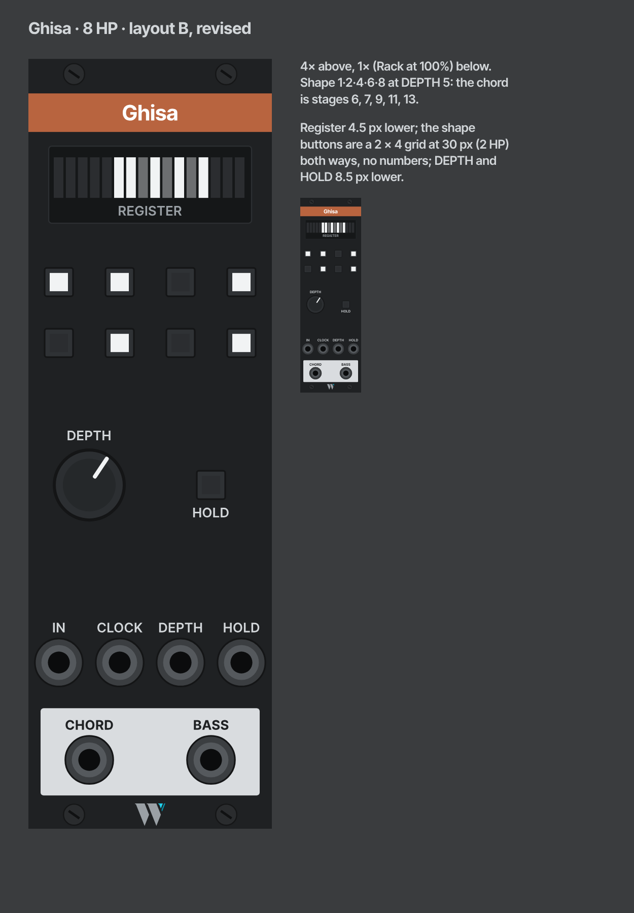

# Ghisa

*The Milanese traffic warden: it stands in the stream of notes and sends each one where the chord needs it.*

Ghisa is a shift register whose taps are a control. Each clock pushes the input's voltage into a 16-stage register. A shape of up to eight stages, drawn with buttons, reads the register into a polyphonic CHORD, and a DEPTH knob with CV slides that shape back through the register, so the same voicing reads from older memory. BASS gives one note of the chord for a bass voice, and CHANGE tells each voice when its note has moved.

- **Family:** trades · **Width:** 8 HP · **Slug:** `Ghisa` · **Since:** not released

## Why

It replaces a patch built by hand again and again, recorded as the *chord from delay taps* technique: a quantizer (OrangeLine Mother) feeds an analogue shift register (ML Shift Register, Count Modula ASR), a few stages that aren't next to each other are merged into a pad, and cvly `bss` takes the root or the lowest note of the merge for a bass. The chord programs itself from the melody's recent past.

The part that hurts is the cabling. Which stages make the chord is set by which jacks are patched, so the voicing can't move or be modulated. Ghisa makes the choice of taps a control, and the movement of that choice a CV.

Ghisa has no quantizer. The quantizer upstream is where the harmony is decided (scale, child scale, weights, fate), and a built-in one would duplicate it and lose. Fed a quantized stream, every tap is in scale.

## Prior art

| Module | What it does | How Ghisa differs |
| --- | --- | --- |
| SickoCV shifter | 64 stages, one output whose stage takes CV | One tap; Ghisa moves a whole voicing |
| Stoermelder SIPO | Shift register with a poly output, CV for skip and step | Evenly spaced taps; Ghisa's shape is drawn freely |
| ML Shift Register, Count Modula ASR, Fundamental SHASR | Fixed outputs per stage | Taps are cables |
| AH Bombe, StudioSixPlusOne Tyrant | Shift-register chord generators | They write the chord; Ghisa reads it from what you played |

## How it works

- **Register.** 16 stages. On each rising edge at CLOCK, every stage passes its voltage one stage down and stage 1 samples IN. Stage 1 is the newest. IN reads its first channel. The register holds any voltage, so it works on pitch, modulation or slow CV alike.
- **Shape.** Eight latching buttons, each with a square light. Button *k* lit means the stage *k* places into the window is in the chord. A fresh Ghisa starts with buttons 1, 3 and 6 (now, two clocks ago, five clocks ago), the shape from the-cliff.
- **DEPTH.** Where the window starts: stage 1 + DEPTH, from 0 to 8, in whole stages. The knob and the CV add (1.25 V per stage, so 0 to 10 V covers the range) and the sum is clamped. At DEPTH 0 the window is stages 1 to 8; at DEPTH 8 it is stages 9 to 16.
- **Changes land on the clock.** A new shape or DEPTH takes effect at the next clock, together with the shift, so the chord only ever changes in time.
- **HOLD.** While the button is on or the HOLD gate is high, each clock recirculates stage 16 into stage 1 instead of sampling IN, so the register loops its last 16 values and the chord repeats every 16 clocks, whatever the shape or DEPTH: a fixed point under the moving voicing.
- **Saved with the patch.** The register's contents and the menu modes are saved, so a patch reopens with the chord it closed on, and Brumista's `get_module_data` can read them: `register` (16 voltages, stage 1 first), `bass` (`lowest` or `root`), `bassOctave` (0 for off, 1 to 3 for C1 to C3) and `chordOrder` (`stage` or `pitch`) and `change` (`trigger` or `gate`).

## Outputs

| Output | Carries |
| --- | --- |
| CHORD | One channel per lit button, holding that tap's voltage. With no button lit it carries one channel at 0 V, since Rack keeps a patched output at one channel at least. |
| CHANGE | One channel per CHORD channel: a 1 ms, 10 V trigger on a clock when that channel's voltage changed (by more than 1 mV), or a gate until the next clock (see *Change* in the menu). |
| BASS | One voltage taken from the tapped stages, by the bass mode. |

All three change only on a clock. CHANGE lets a poly envelope re-attack only the voices that moved, so notes shared by two chords keep sounding: voice leading as articulation. Patch it in place of CLOCK into the pad's envelope. Channels are compared as they leave CHORD, so with *Chord order* set to pitch a channel follows the *n*-th lowest note; a channel that appears when the shape grows fires once.

## Right-click menu

The working modes live in the menu, not on the panel. Like the panel's controls, a change lands on the next clock.

| Item | Choices | Default |
| --- | --- | --- |
| Bass | Lowest: the lowest tapped voltage. Root: the tap that best explains the others as a chord (thirds and fifths above it), scored as `bss`'s Harmonic mode does; a tie goes to the lower note | Lowest |
| Bass octave | Off, or fold the bass into the octave above C1, C2 or C3 | Off |
| Chord order | By stage (button order) or by pitch, low to high | By stage |
| Change | Trigger: 1 ms. Gate until next clock: high from the clock where the channel changed to the next clock, for an envelope that reads a gate; a channel that changes on two clocks in a row drops for 1 ms in between, so the envelope retriggers | Trigger |

## Panel

From the top: the register display just under the band, the shape buttons, DEPTH and HOLD, the inputs (IN, CLOCK, DEPTH, HOLD) and the plate with CHORD, CHANGE and BASS.

- **Shape buttons** form a 2 × 4 grid with a 30 px (2 HP) pitch both ways, unnumbered: the grid reads as the shape, left to right and top to bottom.
- **Off the row grid.** The display, the button grid and the DEPTH row sit a few px off the 48 px rows (in px: register centre 62, buttons 110 and 140, DEPTH and HOLD 210). The inputs and the plate keep their rows.

- **Register display:** sixteen flat bars, one per stage, newest at the left. Off: outside the window. Dim: in the window, not tapped. Full: tapped. The voicing can be watched moving.
- **Shape buttons and HOLD:** the square flat light from [design-system.md](../design-system.md#displays), on a button. A shape button lights when it is on, even before the clock lands it; HOLD lights while the register loops, by the button or the gate.
- **In the module browser** the panel shows a sample: the shape 1·2·4·6·8 at DEPTH 5.
- The generator knows these parts (`button`, `button-grid`, `bars`, the `dy` nudge, a display in the top row), and `panels/Ghisa.json` describes this panel.

## In a patch

- **Self-voicing pad:** a quantized melody into IN, the melody's clock (or a division of it) into CLOCK, CHORD into a poly voice, CHANGE into its envelope, BASS into a mono bass voice.
- **Moving the voicing:** a slow stepped CV into DEPTH reads the same shape from deeper memory, so the pad drifts back through what the melody played.
- **Avoid the collapse.** If the source loops, taps a multiple of the loop's length apart read the same note and the chord thins to one pitch class. Use a loop length coprime with the shift period, randomize the source's clock, or move DEPTH.

## Open questions

- [ ] A right-click choice of HOLD's loop length (16, 8, or the deepest tapped stage), if 16 alone proves limiting.
