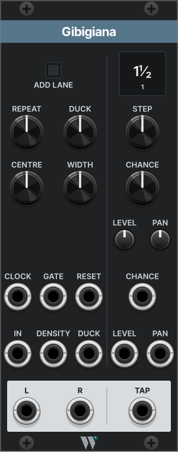

# Gibigiana

*Four echoes on the clock grid, each with its own chance of coming back.*

## What it does

Gibigiana gives one voice its echoes, in time with the clock. It has four taps, and each one plays the voice back a set number of clock steps later. Each tap also has a chance. Some notes come back from one tap, some from three, some from none, so the echo answers the voice instead of copying it.

Each tap has two main knobs. STEP sets how far behind the voice it plays, from a third of a step to 16 steps. CHANCE sets how often it plays at all. A note and its tail always come back together, or not at all. Like Moleta, REPEAT locks the chances into a phrase, and CHANCE then thins it without reshuffling it.

Gibigiana outputs only the echoes, so the dry voice stays where it is in your mix. Every echo is a single bounce, with no feedback. It's built for short voices, drums, plucks and melodies, but anything you can clock works, even CV. Two trimpots shape the echoes' tone, and a DUCK input pulls them down when another voice, like the kick, plays.

Gibigiana is 14 HP wide. It needs a voice in IN and a clock in CLOCK.

## The panel

| Control | What it does |
| --- | --- |
| Readout | Each tap's step. A dim step is too long for the buffer at this tempo, and that tap is silent. |
| STEP 1 to 4 | How many clock steps later the tap plays: ⅓, ½, ⅔, 1, 1⅓, 1½, 2, 2⅔, 3, 4, 6, 8, 12 or 16. |
| CHANCE 1 to 4 | How often a note comes back from this tap. Fully right, always. |
| LEVEL 1 to 4 | How loud the tap is. The middle is -6 dB. |
| PAN 1 to 4 | Where the tap sits in the stereo output. |
| CENTRE | The tone of all four taps. Does nothing until you turn WIDTH left. |
| WIDTH | Fully right, the echoes are untouched. Turn it left to narrow them around CENTRE, like a band-pass. |
| REPEAT | Fully left, every note is a fresh coin flip. Fully right, the pattern locks. |
| DUCK | How far the DUCK input pulls the echoes down. |
| IN | The voice. Mono. |
| CLOCK | Sets the step. Required. |
| GATE | Optional. Patch the voice's gate here and each note gets its own coin flips. Without it, each clock does. |
| RESET | A trigger restarts the locked pattern from the top. |
| DENSITY | CV that adds to or takes from every CHANCE at once. |
| DUCK input | The voice that pushes the echoes aside, usually the kick. |
| L, R | The echoes, in stereo. |
| 1 to 4 | Each tap on its own. Patching one takes that tap out of L and R. |

## Right-click options

The defaults are fine to leave alone.

| Option | What it does | Default |
| --- | --- | --- |
| Patched tap stays in the sum | Keeps a tap in L and R even when its own output is patched. | Off |
| Coin loop | How long a locked pattern is: 8 or 16 notes. | 16 |

## Samples

### Start here: an echo that answers back

1. Add Moleta and VCV's VCO, ADSR, VCA, Mixer and Audio.
2. Patch Moleta's output **1** into the ADSR's gate, and the VCO through the VCA, with the ADSR on its CV. That's the voice.
3. Patch the VCA into a mixer channel, and also into Gibigiana's **IN**. Patch Moleta's **BEAT** into Gibigiana's **CLOCK**.
4. Patch Gibigiana's **L** and **R** into a mixer channel of their own. After two beats, every blip comes back at 1½, 3, 4 and 8 beats.
5. Turn each tap's **CHANCE** down to about half.

You now have echoes that come back some of the time, from different places.

### More ideas

**An echo lane around the kick.** A sparse percussion voice into IN, the kick into DUCK. The echoes fill the gaps the kick leaves.

**Dotted counterpoint.** A melody into IN, its gate into GATE. One tap at 1½ and one at 3, both always on. The line answers itself off the beat.

**Ghost notes.** Four taps at ⅓, ⅔, 1⅓ and 2⅔, with low CHANCE and LEVEL. When a pattern sits well, turn REPEAT right.

**A long tail.** Patch L and R into a reverb. Gibigiana makes the echoes, and the reverb makes the tail.

**When nothing comes back.** Gibigiana needs a clock in CLOCK and two clock pulses before it knows the step. A dim step on the readout means the tap is too long for this tempo.

<!-- Sample patch to come: built in Rack with VCV Fundamental modules only, saved to patches/. -->

## Where it comes from

<!-- Photo to come: a historical photo of sunlight reflected off the water of a Milan naviglio onto a wall, public domain or CC-licensed, with its credit. -->

*Gibigiana: the patch of sunlight that dances on a wall, thrown off water or a window. It comes back from a few places at once, and only some of them catch the light.*

Delay is where my patches do their composing. Prince Of Perception is in more than half of them, nearly always clocked, ducked and fully wet on its own mixer channel. What I wanted from it was echoes on the grid that come back only some of the time, not a longer tail. Gibigiana does only that.

FLAG's Prince Of Perception has feedback, a filter and a duck, but no chance. FrozenWasteland's Portland Weather can give each tap a chance with two expanders, rolled per clock. Gibigiana rolls per note and carries the coin with the echo. 4ms Tapographic Delay, Submit Chrono and CVfunk Tri Delay place taps in other ways, without chance.

Timing details, edge cases and the saved state are in the [reference](gibigiana-reference.md).
