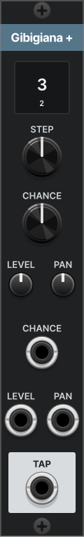

# Gibigiana +

*One more echo lane for the Gibigiana on its left.*

## What it does

Gibigiana + gives a [Gibigiana](gibigiana.md) one more lane: one more echo of the voice, at its own step, with its own chance. Press **ADD LANE** on Gibigiana and it appears after the last lane, or place one from the module browser directly to the right of a Gibigiana or of another Gibigiana +, touching it. There is no cable to patch between them.

A chain holds up to 8 lanes: Gibigiana's own and seven of these. Each one shows its number in its readout. The voice, the clock, the tone, REPEAT and DUCK all live on Gibigiana and drive every lane, and every lane is mixed into Gibigiana's L and R.

Gibigiana + is 4 HP wide. Without a Gibigiana at the head of its chain, it stays silent and its readout dims.

## The panel

| Control | What it does |
| --- | --- |
| Readout | The lane's step, over its number in the chain. Dim when the step is too long for the buffer at this tempo, or when no Gibigiana heads the chain. |
| STEP | How many clock steps later the lane plays: ⅓, ½, ⅔, 1, 1⅓, 1½, 2, 2⅔, 3, 4, 6, 8, 12 or 16. |
| CHANCE | How often a note comes back from this lane. Gibigiana's DENSITY input moves it too. |
| LEVEL | How loud the lane is. The middle is -6 dB. |
| PAN | Where the lane sits in Gibigiana's L and R. |
| CHANCE, LEVEL, PAN inputs | CV added to each knob. |
| TAP | The lane on its own. Patching it takes the lane out of Gibigiana's L and R. |

Everything else is set on Gibigiana. See [Gibigiana's manual](gibigiana.md).

## Samples

### Start here: a second lane

1. Press **ADD LANE** on a Gibigiana that already echoes a voice.
2. The new lane comes back at 3 steps. Turn its **CHANCE** to half and its **PAN** right.

You now have a second echo that comes back some of the time, on the other side.

### More ideas

**One lane, its own processing.** Patch a lane's TAP into a filter or a pitch shifter and back into your mix. It leaves Gibigiana's L and R, and the other lanes stay.

**Removing a lane.** Delete the module. Push the lanes to its right over to close the gap; they keep their knobs, and the coin patterns stay with the places in the chain.

**When a lane is silent.** It must touch its neighbour on the left, all the way back to a Gibigiana. Anything in between, even a blank panel, breaks the chain. A ninth lane is silent too.

## Where it comes from

Gibigiana + has the same story as [Gibigiana](gibigiana.md#where-it-comes-from): one more window catching the sun.

Timing details, edge cases and the saved state are in the [reference](gibigianaplus-reference.md).
