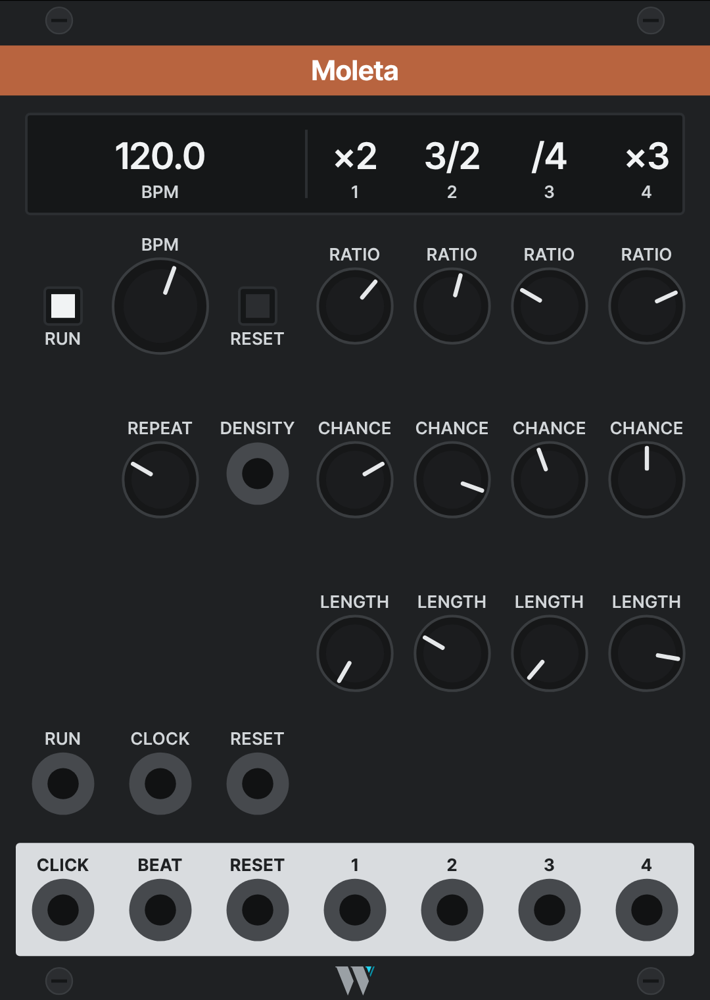

# Moleta

*The itinerant knife grinder: he pedals his wheel at a steady pace, and the sparks fly off it wherever they like.*

> **Designed, not built.** This page is the design. It becomes the manual when Moleta ships, and gets its `manualUrl` then.

Moleta is a master clock whose outputs are each a ratio, a chance and a length. It runs on its own BPM, or follows a clock patched into CLOCK. Each of its four outputs divides or multiplies the beat by a ratio from a short list (fractions such as 3/2 included), lets each pulse through with its own probability, and sends a trigger or a gate of a set length. A REPEAT knob makes the coin flips loop, so the thinned rhythm becomes a phrase. An expander adds four more outputs.

- **Family:** trades · **Width:** 18 HP · **Slug:** `Moleta` · **Since:** not released

## Why

It folds a pair of modules that is patched again and again into one. In a survey of 175 saved patches, a clock output wired into a Bernoulli gate appears in 29 of them, most often SickoCV Clocker into Count Modula Chances, with up to four Chances in one patch. The Chances are used to drop pulses, not to route them: only output A is patched on 59 of 62, and the probability CV is patched once. The probability is set by ear and left.

Two more things push the same way. Clocker has no fractional ratios, so a patch that wants 3/2 moves to CVfunk Syncro, which has no probability either. And Clocker's width stays at its 50% default on 215 of 232 outputs, while what the pulses feed (S&H, envelopes, an arpeggiator) cares whether it gets a trigger or a gate.

## Prior art

No module in an index of about 4,000 has a ratio, a probability and a length on every output; each of these has two of the three at most.

| Module | What it does | How Moleta differs |
| --- | --- | --- |
| SickoCV Clocker / Clocker2 | Master clock, 4 or 6 outputs with integer ratios and a width each | Fractions, and a coin per output |
| CVfunk Syncro | 8 outputs with M/D ratios, one global width | One knob per ratio, a coin and a length per output |
| Count Modula Chances | A coin on one input, A/B outputs | The coin lives on the output it thins |
| Impromptu Clocked | Master clock with 3 sub-clocks, swing | Coins and lengths per output; no swing |
| Sha-Bang Polyrhythm Clock | 3 nested tuplets with a probability each | Ratios relative to the beat, length per output |
| Tyche Kron | One output, density with seeded variants | Four outputs; the coin loops by a knob |
| ALM Pamela's Workout (hardware) | Ratio, width and probability per output on one master clock | The nearest ancestor, with a screen and menus; Moleta keeps each output to three knobs |

## How it works

- **Tempo.** BPM sets the internal clock, shown on the readout. A cable in CLOCK makes Moleta follow it: only rising edges count, so a square LFO at any width works, and the readout shows the measured tempo with CLOCK as its name. Pulling the cable hands back to BPM. The right-click menu sets how many pulses make a beat on CLOCK (1, 4 or 24; default 1).
- **RUN and RESET.** Each is a button and a trigger input. RUN toggles; while stopped, nothing leaves the outputs. RESET restarts every output's cycle and the coin loops together, and fires the RESET output.
- **Ratio.** Each output's RATIO knob steps through /16, /8, /7, /6, /5, /4, /3, /2, 2/3, 3/4, ×1, 4/3, 3/2, ×2, ×3, ×4, ×5, ×6, ×7, ×8, ×16, shown on the readout above its strip. A fresh Moleta starts at ×2, /2, /3 and /4 on outputs 1 to 4. The patch saves the ratio itself, not the knob's step, so the list can grow without changing saved patches.
- **Following a moving clock.** Dividers count edges, so they stay exact at any rate. Multipliers and fractions spread their pulses over the last measured period, and realign on the input edge where their cycle restarts (every edge for ×N, every q edges for p/q), so a modulated LFO stretches the rhythm but never lets it drift. A pulse still pending when that edge arrives is dropped. If the input stops, the outputs stop after about two missed periods instead of running on.
- **CHANCE.** The probability that a pulse passes, per output. DENSITY is one CV input added to all four (10% per volt, so ±5 V moves every CHANCE by half its range), clamped to 0 to 100%.
- **REPEAT.** One knob for the module. Fully left, every pulse flips a fresh coin. Turning it right makes each output replay its last 16 coin flips (8 in the menu), re-flipping fewer of them, until fully right the pattern is locked. The loop stores each flip's random number, not its result, so CHANCE and DENSITY still act on a locked pattern: lowering them removes pulses from the same phrase, raising them adds them back. The loops are saved with the patch, and RESET restarts them.
- **LENGTH.** Fully left sends a 1 ms trigger. Further right it sends a gate from 5% to 95% of that output's own period (at 50%, a ×2 output's gate lasts a quarter of a beat), so the length follows the tempo and a moving clock. It stops short of 100%, so every pulse retriggers.
- **Follow the output above.** A right-click option on outputs 2 to 4, off by default: the output can only pass a pulse while the last pulse of the output above it passed. A dropped /4 then silences the ×2 pulses inside it, so rests fall on whole bars and beats.
- **A fresh Moleta is a plain clock:** CHANCE at 100%, REPEAT fully left, LENGTH at 50%.

## Outputs

| Output | Carries |
| --- | --- |
| 1 to 4 | The pulses that passed, as triggers or gates by LENGTH |
| BEAT | Every beat, ×1, with no coin, for the rest of the patch |
| RESET | A trigger whenever Moleta resets, by button or input |
| CLICK | An audible metronome click, on whenever patched, with an accent on beat 1 of the bar |

## Right-click menu

| Item | Choices | Default |
| --- | --- | --- |
| Clock input | 1, 4 or 24 pulses per beat | 1 |
| Beats per bar | For the CLICK accent | 4 |
| Coin loop | 8 or 16 flips | 16 |
| Follow the output above | Per output, 2 to 4: on or off | Off |

## Panel

The master section is on the left: RUN and RESET buttons either side of the BPM knob, REPEAT and DENSITY on the CHANCE row (so the coin's controls read as one line), the RUN, CLOCK and RESET inputs, and CLICK, BEAT and RESET on the plate. On the right, four strips of RATIO, CHANCE and LENGTH over outputs 1 to 4.

- **Readout row** under the band: BPM, then each strip's ratio over its number. Moleta is the first module with a readout.
- **Seven columns, 37 px apart and 24 px in from the edges**, not the equal shares of the full width the grid uses elsewhere: at 18 HP equal shares put the outer knobs and the outer readout values against the edge. Seven outputs on the plate are what set the width.
- **Off the row grid.** The knob rows sit at 116, 182 and 248 px, spread between the readout and the inputs. The inputs and the plate keep their rows.
- The generator has a `readout` kind with one cell per column, and `columns` with a `col` per control to place them in named columns of a row, leaving the rest empty. `panels/Moleta.json` and `panels/MoletaPlus.json` describe both panels, and `make panels` writes their SVGs and headers.

## Expander

An 11 HP expander placed to the right adds outputs 5 to 8, with the same strips and their ratios on its own readout row. It shares the clock, RESET and the coin loops, and follows the base's REPEAT and DENSITY. Rack passes data between neighbours one sample late, so the base delays its own outputs by one sample while an expander is attached, keeping all eight in line. The panel description calls it "Moleta +" with the slug `MoletaPlus`; the slug becomes permanent when it ships.

Until then, a second Moleta following the first's BEAT gives eight outputs.

## In a patch

- **Thinned clocks:** ×2 at 70% into an arpeggiator's clock, /4 at 60% with a long LENGTH into an envelope in gate mode, ×1 as a trigger into S&H. What used to take a Clocker and three Chances.
- **A phrase to live in:** turn REPEAT right until the drop pattern stops changing, then nudge CHANCE to thin or fill it without losing its shape.
- **Breathing rests:** output 1 at /4 and 60%, output 2 at ×2 with *Follow the output above*: whole bars fall silent together.
- **Following an LFO:** a slow square LFO into CLOCK, its rate modulated; 3/2 and ×3 stretch with it.

## Open questions

- [ ] Which Clocker features (RUN and RESET inputs, external clock) the saved patches use, from a patch scan, to check the master section.
