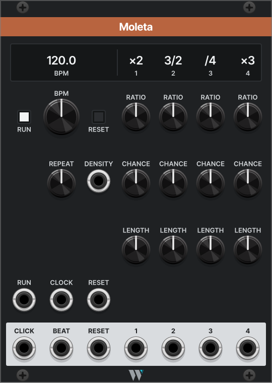
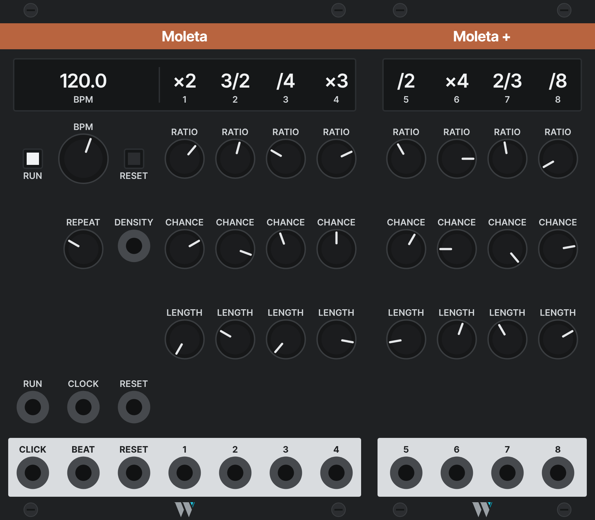

# Moleta

*The itinerant knife grinder: he pedals his wheel at a steady pace, and the sparks fly off it wherever they like.*

Moleta is a master clock whose outputs are each a ratio, a chance and a length. It runs on its own BPM, or follows a clock patched into CLOCK. Each of its four outputs divides or multiplies the beat by a ratio from a short list (fractions such as 3/2 included), lets each pulse through with its own probability, and sends a trigger or a gate of a set length. A REPEAT knob makes the coin flips loop, so the thinned rhythm becomes a phrase.

- **Family:** trades · **Width:** 18 HP · **Slug:** `Moleta` · **Since:** 2.8.0

## Getting started

1. Patch output **1** into a voice's clock or envelope. A fresh Moleta is a plain clock at 120 BPM: outputs 1 to 4 run at ×2, /2, /3 and /4, every pulse passes, and each is a gate half its own period long.
2. Turn **CHANCE** down on an output to thin its pulses. Turn **LENGTH** fully left for 1 ms triggers, or right for longer gates.
3. When a thinned rhythm sounds right, turn **REPEAT** fully right: the pattern locks into a loop of 16 pulses per output.
4. To follow another clock, patch it into **CLOCK**; set *Clock input* in the right-click menu if it runs at 4 or 24 pulses per beat.

## Panel

| Control | What it does |
| --- | --- |
| Readout | BPM, then each output's ratio over its number. While CLOCK is patched, the BPM cell shows the measured tempo (`---` until two beats have arrived); its name stays BPM. |
| RUN | Latching button, lit while running. Stopped, every output is silent and the internal clock is frozen. Turning it on restarts the cycles and the coin loops, as RESET does, without firing the RESET output. |
| BPM | The internal tempo, 30 to 300 BPM, shown with one decimal. A change takes effect at once. Ignored while CLOCK is patched. |
| RESET | Momentary button. Restarts every output's cycle, the coin loops and the bar count, and fires the RESET output. |
| REPEAT | How often the coin loops are redrawn (see below). One knob for all outputs. |
| DENSITY | CV added to every CHANCE, 10% per volt, so ±5 V moves each by half its range. Reads the first channel. |
| RATIO 1 to 4 | Each output's ratio, in 21 steps: /16, /8, /7, /6, /5, /4, /3, /2, 2/3, 3/4, ×1, 4/3, 3/2, ×2, ×3, ×4, ×5, ×6, ×7, ×8, ×16. |
| CHANCE 1 to 4 | The probability that a pulse passes, 0 to 100%. |
| LENGTH 1 to 4 | Fully left, a 1 ms trigger (*Trigger* in the tooltip). Further right, a gate from 5% to 95% of the output's own period; the middle is 50%. |
| RUN (input) | A trigger toggles RUN, like the button. |
| CLOCK | A clock to follow: rising edges only, so a square LFO at any width works. Unpatched, BPM sets the tempo. |
| RESET (input) | A trigger resets, like the button. |
| CLICK | Audio: a metronome click on every beat, higher and louder on beat 1 of the bar. Generated only while patched. |
| BEAT | A 1 ms, 10 V trigger on every beat, with no coin. |
| RESET (output) | A 1 ms, 10 V trigger whenever Moleta resets, by button or input, even while stopped. |
| 1 to 4 | The pulses that passed, 10 V, as triggers or gates by LENGTH. |

In the module browser the readout shows a sample: 120.0, ×2, 3/2, /4 and ×3.

## How it works

- **Tempo.** The internal clock runs a continuous beat phase from BPM. A cable in CLOCK makes Moleta follow it: every first, fourth or 24th rising edge is a beat (*Clock input*), the first edge after connecting, a RESET or RUN being beat 0. The beat period T is the time between the last two beats, so it is unknown until the second one. Pulling the cable hands back to BPM, whose next beat comes one BPM period after the last external beat.
- **Ratios.** A ratio is p pulses every q beats: ×3 is three a beat, /4 one every four beats, 3/2 three every two beats. Each output runs a cycle of q beats, restarted on the beats whose count since the reset is a multiple of q, with a pulse there; the other p − 1 pulses are spread over the cycle at the rate of T. Dividers therefore count beats and stay exact at any rate.
- **Following a moving clock.** Multipliers and fractions spread their pulses over the last measured period and realign on the beat where their cycle restarts (every beat for ×N, every q beats for p/q), so a modulated LFO stretches the rhythm but never lets it drift. A pulse still pending when that beat arrives is dropped, not fired late. If the clock runs slower than predicted, an output waits at the end of its cycle. Before T is known, only the cycle restarts fire. If no beat comes for two periods, the outputs stop until the clock comes back, and the beat that ends such a gap isn't taken as a measure of T.
- **CHANCE and the coin loop.** Each output keeps a loop of 16 stored random numbers (8 with *Coin loop*) and a pointer. On each due pulse the number at the pointer is redrawn with probability 1 − REPEAT, the pulse passes if the number is below CHANCE plus DENSITY (clamped to 0 to 100%), and the pointer moves on either way. Fully left every pulse flips a fresh coin; fully right the loop is locked and the pattern repeats every 16 (or 8) pulses. Because the loop stores numbers rather than results, lowering CHANCE on a locked pattern only removes pulses from the same phrase, and raising it puts them back. RESET and RUN start every loop from its first number.
- **LENGTH.** A gate's length is a share of the output's own period, T × q / p, taken when the pulse fires (at 50%, a ×2 output's gate lasts a quarter of a beat), so it follows the tempo. It stops at 95%, so back-to-back pulses retrigger; if a moving clock brings a pulse while the previous gate is still high, the output drops for one sample first. Before T is known, every pulse is a trigger.
- **Follow the output above.** With this menu option, output 2, 3 or 4 passes a pulse only while the latest pulse of the output above it passed, after that output's own coin and follow, so a chain cascades. Outputs are worked out in order each sample, so pulses that land together see the result above from the same sample. After a reset, the chain starts as passed. A dropped /4 then silences the ×2 pulses inside it, so rests fall on whole bars and beats.
- **CLICK.** A short sine burst, 880 Hz at 2.5 V on ordinary beats and 1760 Hz at 5 V on beat 1 of the bar (*Beats per bar*), decaying in a few tens of milliseconds.
- **Saved with the patch.** The ratios, each output's coin loop (its numbers and pointer) and the menu choices, so a locked phrase reopens as it was.

## Right-click menu

| Item | Choices | Default |
| --- | --- | --- |
| Clock input | 1, 4 or 24 pulses per beat on CLOCK | 1 |
| Beats per bar | 2, 3, 4, 5, 6, 7, 8 or 12, for the CLICK accent | 4 |
| Coin loop | 8 or 16 flips | 16 |
| Follow the output above | Per output, 2 to 4: on or off | Off |

## In a patch

- **Thinned clocks:** ×2 at 70% into an arpeggiator's clock, /4 at 60% with a long LENGTH into an envelope in gate mode, ×1 as a trigger into S&H. What used to take a Clocker and three Chances.
- **A phrase to live in:** turn REPEAT right until the drop pattern stops changing, then nudge CHANCE to thin or fill it without losing its shape.
- **Breathing rests:** output 1 at /4 and 60%, output 2 at ×2 with *Follow the output above*: whole bars fall silent together.
- **Following an LFO:** a slow square LFO into CLOCK, its rate modulated; 3/2 and ×3 stretch with it.

## Expander

[Moleta +](moletaplus.md), an 11 HP expander placed directly to the right, adds outputs 5 to 8, with the same strips and their ratios on its own readout row. It shares the clock, RESET, RUN and *Coin loop*, keeps its own coin loops, and follows the base's REPEAT and DENSITY. Rack passes data between neighbours one sample late, so the base delays all its own outputs by one sample while Moleta + is attached, keeping all eight in line; with nothing attached there is no delay.

## Background

It folds a pair of modules that is patched again and again into one. In a survey of 175 saved patches, a clock output wired into a Bernoulli gate appears in 29 of them, most often SickoCV Clocker into Count Modula Chances, with up to four Chances in one patch. The Chances are used to drop pulses, not to route them: only output A is patched on 59 of 62, and the probability CV is patched once. The probability is set by ear and left.

Two more things push the same way. Clocker has no fractional ratios, so a patch that wants 3/2 moves to CVfunk Syncro, which has no probability either. And Clocker's width stays at its 50% default on 215 of 232 outputs, while what the pulses feed (S&H, envelopes, an arpeggiator) cares whether it gets a trigger or a gate.

No module in an index of about 4,000 has a ratio, a probability and a length on every output; each of these has two of the three at most.

| Module | What it does | How Moleta differs |
| --- | --- | --- |
| SickoCV Clocker / Clocker2 | Master clock, 4 or 6 outputs with integer ratios and a width each | Fractions, and a coin per output |
| CVfunk Syncro | 8 outputs with M/D ratios, one global width | One knob per ratio, a coin and a length per output |
| Count Modula Chances | A coin on one input, A/B outputs | The coin lives on the output it thins |
| Impromptu Clocked | Master clock with 3 sub-clocks, swing | Coins and lengths per output; no swing |
| Sha-Bang Polyrhythm Clock | 3 nested tuplets with a probability each | Ratios relative to the beat, length per output |
| Tyche Kron | One output, density with seeded variants | Four outputs; the coin loops by a knob |
| ALM Pamela's Workout (hardware) | Ratio, width and probability per output on one master clock | The nearest ancestor, with a screen and menus; Moleta keeps each output to three knobs |

The panel has seven columns 37 px apart and 24 px in from the edges, not the equal shares of the full width the grid uses elsewhere: at 18 HP equal shares put the outer knobs and readout values against the edge. Its knob rows sit off the row grid, at 116, 182 and 248 px. `panels/Moleta.json` describes it.

## Saved state

What Moleta saves beyond its parameters, as Brumista's `get_module_data` reads it:

| Key | Holds |
| --- | --- |
| `ratios` | Four objects `{"p", "q"}`, outputs 1 to 4: the ratio itself. On load, each RATIO knob goes to the step with that ratio, or the nearest one. |
| `coins` | Four objects, outputs 1 to 4: `slots`, the 16 stored numbers (0 to 1), and `pointer`, the next slot |
| `clockInput` | 1, 4 or 24 pulses per beat |
| `beatsPerBar` | 2 to 8, or 12 |
| `coinLoop` | 8 or 16 |
| `follow` | Three booleans, outputs 2 to 4 |

A missing or unknown value loads as its default.

## Open questions

- [ ] Which Clocker features (RUN and RESET inputs, external clock) the saved patches use, from a patch scan, to check the master section.
