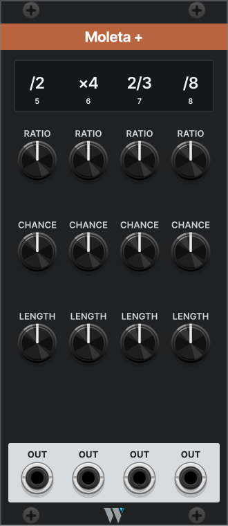

# Moleta +

*Four more outputs for the Moleta on its left, each with its own ratio, chance and length.*

## What it does

Moleta + gives a [Moleta](moleta.md) four more outputs, numbered 5 to 8. Place it directly to the right of a Moleta, touching it. There is no cable to patch between them.

Want more? Chain up to four, each touching the one before: the second adds outputs 9 to 12, the third 13 to 16, the fourth 17 to 20. The readout shows which outputs a Moleta + has.

Each new output works like Moleta's own. RATIO sets how fast it ticks, CHANCE how many ticks get through, and LENGTH whether they are triggers or gates. Moleta's tempo, RUN, RESET, REPEAT and DENSITY drive every output in the chain, so one REPEAT knob locks every pattern at once.

Moleta + is 11 HP wide. Away from a Moleta, its outputs stay silent.

## The panel

| Control | What it does |
| --- | --- |
| Readout | Each output's ratio, over its number. The numbers show once the module is linked to a Moleta. |
| RATIO 5 to 8 | How fast the output ticks against Moleta's beat, from /32 to ×32. |
| CHANCE 5 to 8 | How often a tick gets through. Moleta's DENSITY input moves these too. |
| LENGTH 5 to 8 | Fully left, a short trigger. Further right, a longer gate. |
| OUT | The ticks that got through, one per column. Mono. |

Everything else, the tempo, REPEAT and the clock options, is set on Moleta. See [Moleta's manual](moleta.md).

## Right-click options

| Option | What it does | Default |
| --- | --- | --- |
| Follow the output above | The second, third and fourth outputs only play while the output to their left is playing. | Off |

## Samples

### Start here: eight outputs

1. Place Moleta + directly to the right of a Moleta.
2. Patch output **5** into a voice. It ticks at ×4, every tick passing.
3. Turn **CHANCE 5** down to thin it, and Moleta's **REPEAT** right to lock it.

You now have a fifth output, locked with Moleta's four.

### More ideas

**Drums on Moleta, melody on Moleta +.** Moleta's four outputs on drums, the expander's four on a melody line and its accents. One REPEAT locks the lot.

**Silence that spreads.** Output 5 at /4 and 60%. Outputs 6 to 8 at ×2, ×3 and ×4, each with *Follow the output above* on. A rest on 5 silences the whole row.

**When the outputs are silent.** Moleta + must touch the Moleta on its left, or the Moleta + before it in a chain. Anything in between, even a blank panel, breaks the link, and a fifth Moleta + stays silent.

## Where it comes from

Moleta + has the same story as [Moleta](moleta.md#where-it-comes-from): the grinder's second wheel, same pedals, same pace, more sparks.

Timing details, edge cases and the saved state are in the [reference](moletaplus-reference.md).
